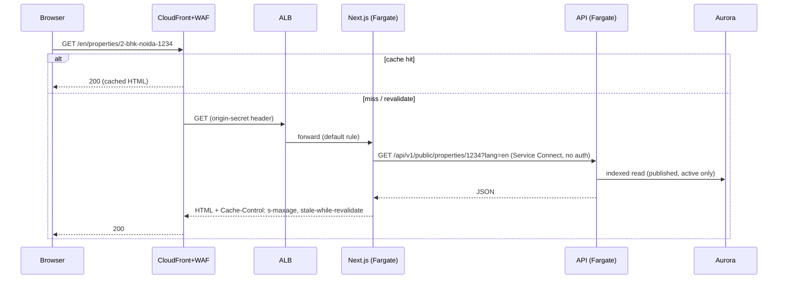
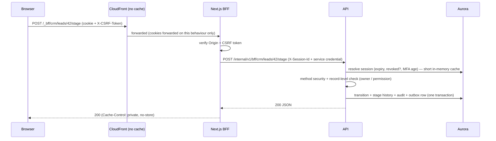

# ARCHITECTURE.md — UNAVORA ANANT INFRA Platform

| | |
|---|---|
| **Version** | 2.0 (revision after director review) |
| **Date** | 7 November 2026 |
| **Status** | Approved v2.0; amended 2026-11-07 with §5.1 customer signup. No infrastructure created; application code exists locally (see TEST_RESULTS.md) |
| **Region assumed** | AWS `ap-south-1` (Mumbai) |
| **Currency assumption** | ₹95 per US$1 (market quotes seen: ₹94.5–96.5; re-check before any budget sign-off) |

> **Provenance note.** The v1 draft you reviewed was not available to me in this session, so this is a complete restatement that incorporates your ten review points and the local-first mandate. Section 0.3 records what changed relative to those ten points. Companion documents (DATABASE_DESIGN, AWS_COST_ESTIMATION, SECURITY_ARCHITECTURE, MOBILE_AND_SEO_STRATEGY, PENDING_BUSINESS_CONFIRMATIONS) are **not** revised here and must be reconciled with this version before Phase 1.

---

## 0. How to read this document

### 0.1 Status tags (used on every decision)

| Tag | Meaning |
|---|---|
| **[C] Confirmed** | Agreed by the director. Changing it needs a decision-log entry. |
| **[R] Recommended** | My recommendation with reasoning; needs your approval. |
| **[U] Unresolved** | Depends on a business input or a comparison not yet possible. |
| **[V] Console/doc verification** | Price, limit, version or feature that must be checked in the AWS console, AWS Pricing Calculator or official docs before it is relied on. |
| **[L] Load test** | A number that is a hypothesis until measured in staging. |

Prices below come from secondary sources retrieved today (AWS pages were not directly readable). **Every price is therefore [V].** Where I could not find a figure I say so rather than estimate it.

### 0.2 Confirmed decisions [C]

1. Next.js (App Router) + React + TypeScript frontend; Angular is dropped.
2. Spring Boot + Java backend as a **modular monolith**, one codebase, one PostgreSQL database. No microservices.
3. PostgreSQL as the single central database for website, CRM and future mobile app.
4. AWS as cloud: ECS Fargate, ALB, S3, CloudFront, WAF, SQS, Secrets Manager, KMS, CloudWatch.
5. Web authentication through a Next.js BFF with HttpOnly cookies; tokens stay server-side.
6. Mobile (future) uses direct `/api/v1/**` with OAuth 2.0 Authorization Code + PKCE.
7. Transactional outbox → SQS for notifications; at-least-once delivery with idempotent consumers.
8. Private database networking, encryption, per-record authorisation, director MFA, private document storage.
9. English + Hindi from first release; React Native later using the same API; AI later via a provider-neutral module only.
10. **Local-first delivery** (Section 14): local → test → staging → human approval → production. No AWS resources, Terraform apply, DNS change or live payment without explicit approval.

### 0.3 Change summary against your ten review points

| # | Your point | What changed in v2 | Section |
|---|---|---|---|
| 1 | Auth/routing conflict | ALB no longer sends browser traffic to `/api/*`. Browsers use same-origin `/_bff/**`; mobile/machines use `/api/v1/**`; `/internal/**` is never routed by ALB. Four sequence diagrams added. | 3, 4 |
| 2 | CloudFront plans | Full Pro / Business / pay-as-you-go comparison against our eight cache behaviours. Recommendation is **pay-as-you-go**, not Pro. Several plan features are [V]. | 7.5 |
| 3 | DB connections | Explicit formula, worst case incl. rolling deployments, tied to Aurora minimum-ACU limit; Terraform guard proposed. | 8 |
| 4 | Aurora version | Updated from AWS release notes; PostgreSQL 17.x recommended, exact minor [V]. | 6.3 |
| 5 | Autoscaling | 20-second ECS metrics documented; detection, provisioning, cooldown and cap defined; every figure tagged [L]. | 7.3 |
| 6 | NAT | One vs two NAT compared with failure scenarios and cost delta; one NAT recommended with mitigations. | 7.2 |
| 7 | Cost | Full-stack baseline (not just ECS) for production and staging, in ₹. | 9 |
| 8 | Outbox | Relay, loss prevention, duplicates and idempotency specified, including the honest limit for external providers. | 10 |
| 9 | Security | Preserved; kept simple (no extra services added). | 11 |
| 10 | Document | Registers of [C]/[R]/[U]/[V]/[L] in Section 16. | 16 |
| + | Local-first mandate | New section; local identity provider and no-AWS startup added to design. | 14 |

---

## 1. Purpose, scope and principles

A premium, mobile-first, bilingual real-estate platform comprising: public website, property/project catalogue, CRM (customer 360, leads, tasks, visits, deals), employee and director dashboards, CMS, notifications, payments (sandbox first), and APIs reusable by a future mobile app.

Principles:

1. **One backend, one database.** Website and mobile share business logic.
2. **Smallest architecture that meets the need.** No Redis, Kafka, Elasticsearch, Kubernetes or AI server until measurement requires them.
3. **Server-enforced security.** UI hiding is cosmetic.
4. **Cost is a design constraint.** Hard maximums on tasks and database capacity; budget alerts are not caps.
5. **Honest status.** Nothing is "done" unless executed and evidenced.

Out of scope here: application code, Terraform, DNS changes, AWS resource creation.

---

## 2. Technology selection and reasons

| Area | Choice | Why selected | Main risk | Alternative considered |
|---|---|---|---|---|
| Frontend | Next.js App Router, React, TypeScript, Tailwind | Server-rendered HTML for SEO in two languages; ISR for property pages; one React skill set shared with React Native | Next.js caching semantics are subtle; version churn | Angular (rejected earlier), Astro (weaker for dashboards) |
| Backend | Java LTS + Spring Boot, Spring Security, JPA, Flyway | Strong fit for transactional CRM rules, mature security, team direction | JVM cold start ~tens of seconds slows scale-out | Node/NestJS (single language, but weaker typed domain/ORM ecosystem for this team) |
| Database | PostgreSQL | Relational integrity for customers/leads/deals; JSONB; full-text; row-level options | Single writer is the scaling limit | MySQL (cPanel already has it, but no advantage) |
| Compute | ECS Fargate | No servers to patch; per-second billing; simple autoscaling | Costlier per vCPU than EC2; slower scale than warm pool | App Runner, EC2 ASG, Lightsail (cheaper but less scalable/secure) |
| Queue | SQS standard + DLQ | Cheap, managed, at-least-once | No ordering/exactly-once — handled in design | SNS+SQS, FIFO (not needed) |
| Identity | OIDC provider; Cognito recommended [R] | Managed MFA/TOTP, no password handling in our code | Cognito feature/price fit not yet confirmed; local dev needs a substitute | Keycloak self-hosted (ops burden), Spring Authorization Server |
| IaC / CI | Terraform, GitHub Actions + OIDC | Reviewable plans, no long-lived keys | — | CDK |

Versions **[V]**: target Java 25 LTS with Java 21 LTS as fallback, Spring Boot 4.x line, current Node.js LTS. Pin exact versions at Phase 1 after checking the Spring Boot ↔ Java ↔ Hibernate compatibility matrix. Do not pick a version just because it is newest.

---

## 3. Logical architecture

```text
                         Customers / Employees / Directors            Future React Native app
                                  (browsers)                           (Android / iOS)
                                      │                                       │
                                      ▼                                       ▼
                         ┌──────────────────────────── DNS (Route 53 or existing registrar) ────────────┐
                                                      │
                                                      ▼
                                   CloudFront  (+ AWS WAF web ACL, TLS from ACM)
                      ┌───────────────┬──────────────┼───────────────────────┬──────────────────┐
                      │               │              │                       │                  │
              /media/*        /_next/static/*   pages, /_bff/**        /api/v1/**         /webhooks/**
                      │               │              │                       │                  │
                      ▼               └──────┬───────┘                       └────────┬─────────┘
              S3 public-media (OAC)          ▼                                        ▼
                                  ┌── Application Load Balancer (public subnets) ─────────────────┐
                                  │  accepts only CloudFront origin-facing IPs + secret header     │
                                  │  rule A: /api/v1/* , /webhooks/*  → API target group           │
                                  │  default: everything else         → Web target group           │
                                  │  NO rule for /internal/*                                       │
                                  └───────────┬───────────────────────────────────┬────────────────┘
                                              ▼                                   ▼
                                   ECS: Next.js web (2+)               ECS: Spring Boot API (2+)
                                              │  private call via ECS Service Connect  ▲
                                              └────────── /internal/v1/** (port 8081) ─┘
                                                                                  │
                                           ┌──────────────────────────────────────┼───────────────────────┐
                                           ▼                                      ▼                       ▼
                                  Aurora PostgreSQL               ECS: Worker (same codebase,      S3 private-documents
                                  (private data subnets)          `worker` profile) ◄── SQS ◄──    S3 raw-uploads
                                                                  outbox relay ─────────────►     (pre-signed URLs only)
                                                                         │
                                                                         ▼
                                                        Email (SES/SMTP) · WhatsApp Cloud API (later) · Payment gateway
```

Egress from private subnets to the internet (email APIs, payment API, IdP JWKS, ECR) goes through one NAT Gateway (Section 7.2).

### 3.1 Backend modules (inside one deployable)

`platform`, `identity`, `properties`, `projects`, `crm`, `visits`, `deals`, `payments`, `notifications`, `storage`, `cms`, `analytics`, `audit`, `ai` (interface only).

Rules: modules talk through service interfaces with IDs and DTOs, never through each other's JPA entities; ArchUnit tests enforce this. One runtime image, two Spring profiles: `api` and `worker`. Leads, visits and customers exist once (CRM-owned); the "main application" and CRM do not have parallel tables. Lead pipeline and deal lifecycle are separate state machines (detailed in DATABASE_DESIGN.md).

---

## 4. Request flows (authoritative)

### 4.1 Routing contract

| Path | Caller | Goes to | Auth | Cached at CDN |
|---|---|---|---|---|
| `/en/**`, `/hi/**` (public pages), `/sitemap*.xml`, `/robots.txt` | Browser | Next.js | none | Yes (origin `Cache-Control`) |
| `/_next/static/**` | Browser | Next.js | none | Yes, immutable |
| `/media/**` | Browser | S3 public bucket via OAC | none | Yes, long |
| `/_bff/**` | **Browser only** | Next.js route handlers | session cookie + CSRF | **Never** |
| `/dashboard/**`, `/account/**` | Browser | Next.js (server-rendered, per-user) | session cookie | **Never** |
| `/api/v1/public/**` | Browser/Next.js/mobile | API | none; `Authorization` and cookies **not forwarded** | Yes, short |
| `/api/v1/**` (other) | **Mobile / machine clients** | API | OAuth2 Bearer JWT | **Never** |
| `/webhooks/**` | Payment/WhatsApp/SES providers | API | provider signature | **Never** |
| `/internal/v1/**` (port 8081) | Next.js server only | API | service credential + SG | n/a — **not routable from ALB** |

**How the original conflict is resolved:** browser JavaScript never calls `/api/v1/**` for authenticated actions. It calls same-origin `/_bff/**`, where Next.js attaches the session context and calls the API privately. `/api/v1/**` exists for mobile, partners and server-to-server use, and for the OpenAPI contract. Both paths terminate in the same Spring Security principal and the same method/record-level checks, so there is one authorisation implementation.

### 4.2 Public page (anonymous)



### 4.3 Web login (staff) — authorisation-code flow, tokens never leave the API

```mermaid
sequenceDiagram
  participant B as Browser
  participant W as Next.js BFF
  participant A as API (identity module)
  participant IdP as OIDC provider
  B->>W: GET /_bff/auth/login
  W->>A: POST /internal/v1/auth/start
  A-->>W: authorize URL (state, nonce, PKCE challenge); verifier stored server-side
  W-->>B: 302 to IdP (hosted UI)
  B->>IdP: sign in + MFA (mandatory for directors)
  IdP-->>B: 302 /_bff/auth/callback?code&state
  B->>W: GET /_bff/auth/callback?code&state
  W->>A: POST /internal/v1/auth/complete {code,state}
  A->>IdP: token request (confidential client + PKCE verifier)
  IdP-->>A: id/access/refresh tokens
  A->>A: validate JWT, map sub→users row, record MFA time, create session row (refresh token KMS-encrypted)
  A-->>W: opaque session id (no tokens)
  W-->>B: Set-Cookie __Host-uai_session=<opaque>; HttpOnly; Secure; SameSite=Lax; Path=/
```

### 4.4 Authenticated web request



### 4.5 Mobile (future) — direct API

```mermaid
sequenceDiagram
  participant M as React Native app
  participant IdP as OIDC provider
  participant CF as CloudFront+WAF
  participant A as API
  M->>IdP: system browser: authorize (code + PKCE, public client, no secret)
  IdP-->>M: redirect to app link with code
  M->>IdP: token request with code_verifier
  IdP-->>M: access + refresh tokens (stored in Keychain / Keystore)
  M->>CF: GET /api/v1/leads (Authorization: Bearer JWT)
  CF->>A: pass-through (never cached)
  A->>A: validate signature, issuer, audience (mobile client), expiry; same RBAC + record checks
  A-->>M: JSON (cursor-paginated)
```

### 4.6 Rules that keep web and mobile consistent

- Separate IdP app clients: `web-bff` (confidential, API-held secret) and `mobile` (public, PKCE). The API checks the client/audience claim and refuses a Bearer token on `/internal/**` and a session id on `/api/v1/**`.
- Session state lives in PostgreSQL (`identity` module): opaque id (hashed at rest), user, created/expiry, last-seen, MFA timestamp, revocation flag. This gives instant revocation and director step-up without Redis. **[R]** Alternative: encrypted stateless cookie holding tokens — simpler but tokens would sit in the browser (encrypted), revocation is weak. Not recommended given your "tokens server-side" requirement.
- `/internal/**` is protected by: no ALB rule; security group allowing port 8081 only from the web service; an HMAC service credential from Secrets Manager; and no CloudFront behaviour.
- Cookie is `__Host-` prefixed; mutating BFF routes require `Origin` check plus synchroniser token. Session idle timeout and absolute timeout are configurable [U] (suggest 30 min idle / 12 h absolute for staff; directors shorter).
- Public cacheable content is cookie-independent: CloudFront does **not** forward cookies on public behaviours, so a login cookie can never fragment or poison the cache.

---

## 5. Authentication and authorisation model [R]

- **Authentication:** OIDC provider. Cognito recommended for staff (TOTP MFA, hosted UI, no password handling in our code). Customer accounts (saved properties, alerts) are a later population; anonymous enquiry never requires login.
- **Authorisation:** roles/permissions/ownership stored in PostgreSQL, not in the IdP. Checks at three layers: endpoint permission, record-level ownership/assignment filter in the query (not post-filtering), and field-level masking (for example deal financials visible to directors only).
- **Director MFA:** mandatory at IdP; the API also checks "MFA performed at" on high-risk operations (role change, export, price/approval edits, deal financials) and demands re-authentication if older than a configured age [U: suggest 15 min].
- **Customers (amendment 2026-11-07, approved requirements):** see §5.1. This replaces "customer accounts are a later population"; anonymous enquiry still never requires login.
- **Local development:** Cognito cannot run on a laptop. The API depends only on standard OIDC (issuer, JWKS, authorize/token endpoints). Local profile uses a Keycloak container with an imported dev realm; staging/production use Cognito. A contract test suite runs against both, and staging validation catches provider differences [L-like risk, see R-06].

### 5.1 Customer signup and login (amendment 2026-11-07)

Approved requirements and how they are met. Status values as in TEST_RESULTS.md.

| Requirement | Design | Local status |
|---|---|---|
| Continue with Google for customer signup/login | Next.js BFF runs Authorization Code + PKCE + state + nonce against Google; the API verifies the ID token (JWKS signature, `iss`, `aud` = our client id, `exp`, `email_verified`) | Implemented. **Mock adapter** tested PASS; real Google NOT RUN (needs approved OAuth client) |
| Save Google account ID, name, Gmail, registration date, last login | `customer_identities(provider='google', provider_subject, email, display_name, registered_at, last_login_at, login_count)` | PASS (mock) |
| Collect WhatsApp number, verify by WhatsApp OTP via approved provider | `phone_verifications` + `WhatsAppOtpSender` port; codes HMAC-hashed, 10 min, 5 attempts, resend limits (D-018) | Mock sender PASS; real provider BLOCKED |
| Automatically create customer profile in PostgreSQL | first verified login inserts `customers` (`registered_at`, `signup_source='google'`) | PASS |
| No duplicate profile on later logins | UNIQUE(provider, provider_subject) + transaction advisory lock; existing enquiry-only customer with same email → `customer_duplicate_candidates`, never auto-merged | PASS |
| Registered customers visible in CRM without an enquiry | `GET /api/v1/staff/customers?registered=true` (customer.read_all); employees see only customers linked to their leads | PASS |
| Separate lead per enquiry / callback / site visit | `/internal/v1/customer/requests` → new `leads` row each time (`enquiry_type` property/general, callback, site_visit; source `website_account`) | PASS |
| Enquiry consent and marketing consent recorded separately | `customer_consents` rows `service_contact` and `marketing_whatsapp`, append-only, notice version | PASS |
| Sales staff get contact details + WhatsApp/call actions | staff customer detail returns phone/WhatsApp, `tel:` and `https://wa.me/` actions to authorised callers only | PASS (API). Staff web UI not built |
| Communication history and follow-ups | `communication_logs` (employee_recorded / recorded_manual; a wa.me click is never "delivered") and `crm_tasks` | PASS (API) |

```mermaid
sequenceDiagram
  participant B as Browser
  participant W as Next.js BFF
  participant G as Google (or local mock chooser)
  participant A as API /internal/v1 (service credential)
  participant DB as PostgreSQL
  B->>W: GET /_bff/auth/google/start
  W-->>B: 303 to Google (state, nonce, PKCE) + HttpOnly state cookie
  B->>G: choose account
  G-->>B: 302 /_bff/auth/google/callback?code&state
  B->>W: callback
  W->>G: code + verifier + client secret -> id_token (server side)
  W->>A: POST /customer-auth/google {credential}
  A->>A: verify id_token (JWKS, iss, aud, exp, email_verified)
  A->>DB: advisory lock(sub); find identity or create customer+identity; session (hash)
  A-->>W: opaque session token
  W-->>B: Set-Cookie __Host-uai_customer (HttpOnly, Secure, SameSite=Lax)
  B->>W: server action: send WhatsApp code
  W->>A: POST /customer/whatsapp/otp (X-Customer-Session)
  A->>A: WhatsAppOtpSender (approved provider; mock locally)
  B->>W: server action: verify code
  W->>A: POST /customer/whatsapp/verify -> customers.whatsapp_verified_at
```

**Staff and directors are unchanged:** invitation-based accounts only (no self-registration), OIDC via Keycloak locally and Cognito later, director MFA mandatory in staging/production (D-021). Customer and staff identities never share a table or a session type: customers have `customer_sessions` and are never in `users`.

**Local development:** `CUSTOMER_GOOGLE_MODE=mock` and `WHATSAPP_OTP_MODE=mock` are set only by the `local` and `test` profiles. Staging and production have no defaults, so startup fails unless a mode is chosen explicitly, and they must never use `mock`. Nothing in this repository claims that real Google or WhatsApp is operational.

---

## 6. Data tier

### 6.1 Model principles
Single schema set, UUID keys, Flyway-only migrations, Hibernate `ddl-auto=validate`, foreign keys + check constraints, soft delete where justified, audit history. Full design in DATABASE_DESIGN.md.

### 6.2 Aurora Serverless v2 vs provisioned RDS **[U]**

| | Aurora Serverless v2 | Provisioned (RDS PostgreSQL or Aurora provisioned) |
|---|---|---|
| Idle floor | Pays for minimum ACU, 24×7 | Pays for the instance, 24×7 |
| Scaling | Capacity moves in 0.5-ACU steps without restart | Resize requires a change (brief interruption) |
| Memory per unit | 1 ACU ≈ 2 GiB | Fixed by instance class |
| Fit | Spiky/unknown load; wide min–max range | Steady, predictable load |
| Cost evidence | Rate seen: ~US$0.18/ACU-hour in Mumbai [V] | **I do not have a verified Mumbai price for a small instance**; must be taken from the AWS Pricing Calculator [V] |

Recommendation **[R]**: start with Aurora Serverless v2 (min 1 ACU, max 4 ACU) because traffic is unknown and spikes are expected. Revisit after the load test and 2–3 months of real usage; if average ACU stays near the floor and the calculator shows a cheaper provisioned instance with acceptable memory, switch. This is decided by numbers, not assumption — the comparison row for provisioned cost remains **[U/V]**.

Availability trade-off: a single Aurora writer with no reader means an AZ or instance failure causes an outage while Aurora recovers (storage is replicated across three AZs, compute is not). A reader in a second AZ shortens failover but roughly doubles compute cost. Choose after RPO/RTO are confirmed **[U]**; recovery times are [V]/[L].

### 6.3 Engine versions (Mumbai) — updated
From AWS documentation retrieved today:
- Aurora Serverless v2 is supported in Asia Pacific (Mumbai) with Aurora PostgreSQL minimum versions 17.4, 16.1, 15.2, 14.3, 13.6 (and higher).
- Aurora PostgreSQL release notes list 18.3 and 17.9 (and 16.13, 15.17, 14.22 announced April 2026).
- PostgreSQL 14 community end-of-life is 12 Nov 2026 and Aurora standard support for 14 ends 28 Feb 2027 — **do not use 14**. Older minor versions also have end-of-standard-support dates, so we pin the newest minor and schedule minor upgrades.

Recommendation **[R]**: **PostgreSQL 17.x** (latest minor offered in Mumbai), with the same major in Docker/Testcontainers. PostgreSQL 18.x is the planned upgrade once its Aurora Mumbai availability and our extensions are confirmed.
**[V]** Exact minor version and Serverless v2 availability must be confirmed with `aws rds describe-db-engine-versions --engine aurora-postgresql --region ap-south-1` or in the console before Terraform is written. Release notes do not state regional availability.

### 6.4 Search
PostgreSQL indexes and full-text search first. No Elasticsearch/OpenSearch. Cursor pagination everywhere. Revisit only if measured query latency requires it.

---

## 7. AWS deployment architecture (design only — nothing is created)

### 7.1 Network
Two Availability Zones. Public subnets: ALB, NAT. Private app subnets: ECS tasks. Private data subnets: Aurora (no public IP). Security groups: ALB accepts only the CloudFront origin-facing managed prefix list (plus the secret `X-Origin-Verify` header checked in the listener rule); web SG → API SG on 8081 only; API/worker SG → DB SG on 5432 only. S3 gateway endpoint (free) to keep S3 traffic off the NAT **[R]**. Public IPv4 addresses are billed hourly (ALB ×2, NAT ×1) **[V]**.

### 7.2 NAT Gateway: one or two? **[R] one at launch; [U] pending availability target**

What depends on NAT: new tasks pulling images from ECR and secrets/log endpoints at start, outbound email/WhatsApp/payment API calls, IdP JWKS refresh. What does **not**: the user-facing path CloudFront → ALB → tasks → Aurora → S3 (gateway endpoint).

| | One NAT (AZ-a) | Two NATs (one per AZ) | VPC interface endpoints instead of NAT |
|---|---|---|---|
| Added hourly cost | baseline | + ~US$41/mo NAT + ~US$3.7 IPv4 ≈ **+₹4,200/mo** [V] | ~6 endpoints × 2 AZ × ~US$7.3 ≈ US$88/mo — **costlier than NAT** at our scale [V] |
| AZ-a fails (NAT lost) | Running tasks in AZ-b keep serving users. Outbound calls fail: emails queue in SQS/outbox and retry; JWKS served from cache; **new/replacement tasks cannot start** (no ECR path) so scale-out and deployments stall until recovery | Both AZs keep outbound and task start | n/a |
| AZ-b fails | No NAT impact (NAT is in AZ-a); tasks in AZ-b are lost, ALB shifts to AZ-a | Same | — |
| Cross-AZ traffic | AZ-b tasks pay cross-AZ transfer to reach NAT (small) | Avoided | — |
| Operational notes | Simple; documented runbook: if AZ-a NAT is down, freeze deployments; `terraform apply` of a second NAT is a ~minutes recovery option | Highest resilience | Adds many billable items |

Reasoning: for a lead-generation/CRM site the failure mode "emails delayed, cannot scale/deploy during an AZ outage" is tolerable because the outbox preserves every event. If the director requires "scaling and deployments must work during an AZ failure", choose two NATs (+₹4,200/mo). The decision is made **after RPO/RTO confirmation [U]**. Running tasks in public subnets without NAT is rejected on security grounds (tasks would hold public IPs).

### 7.3 ECS Fargate services and autoscaling

Three services from two images (web; API/worker image with two profiles):

| Service | Task size (hypothesis [L]) | Min (warm baseline) | Launch max | Notes |
|---|---|---:|---:|---|
| Next.js web | 0.5 vCPU / 1 GB | 2 (one per AZ) | 6 | ALB request-count + CPU |
| Spring Boot API | 1 vCPU / 2 GB | 2 (one per AZ) | 6 | CPU + memory + request count |
| Worker | 0.5 vCPU / 1 GB | 1 | 3 | SQS backlog-per-task |

Earlier draft maxima were 8/8/4. I recommend **launching with 6/6/3** and raising after load tests; this lowers the theoretical cost ceiling and the database connection budget (Section 8). Task sizes, counts and CPU targets are hypotheses **[L]**. ARM/Graviton images (about 20% cheaper Fargate rate, [V]) are recommended if all dependencies support it; verify in CI.

**Detection speed.** ECS publishes `CPUUtilization`/`MemoryUtilization` every 60 s by default. Since June 2026 target tracking can use **20-second high-resolution** metrics. Enabling it on an existing service is two steps (update monitoring resolution → deployment completes → attach the high-resolution policy). High-resolution metrics incur normal CloudWatch charges; an AWS example for four services is roughly US$1.4–2.5/month [V]. **[R]** enable for web and API; workers scale on queue backlog.

**Realistic time from load rise to extra capacity [L] (to be measured, not promised):**

| Stage | Expected range (hypothesis) |
|---|---|
| Metric detection + alarm (20 s metrics, 3 datapoints) | ~1 min (≈3 min with 60 s metrics) |
| Task provisioning (ENI, image pull, container start) | tens of seconds to ~1.5 min |
| JVM start + Spring context | ~20–60 s (Web tier faster) |
| ALB health checks to "healthy" | ~20–30 s |
| **Total** | **roughly 2–4 minutes** |

Therefore scaling is **not instantaneous**. Protection against the gap: (1) a warm baseline of two tasks per tier, (2) CloudFront caching of public pages so most spike traffic never reaches Fargate, (3) ALB slow start and 30–60 s deregistration delay, (4) JVM tuned for fast start (CDS/AppCDS, lazy init where safe).

**Policies [R]:** target tracking (CPU ~60%, request count per target as second signal); scale-out cooldown 60 s; **scale-in cooldown 300–600 s** (scale in slowly to avoid thrash and connection churn); minimum capacity never below the AZ-spread baseline; deployment circuit breaker + rollback enabled; rolling deployments at `maximumPercent` 150 (Section 8 depends on it).

**Hard maximums:** `max_capacity` on each service, Aurora max ACU, and a Terraform check that Σ(pool × max tasks) stays inside the DB connection budget. Fargate **service quotas** (vCPU) in ap-south-1 must be checked **[V]**; a quota is a safety net, not a cost control. AWS Budgets and Cost Anomaly Detection are alerts only.

**Load-test obligations [L]** (Phase 6, staging only): time-to-alarm, time-to-RUNNING, time-to-healthy, p50/p95/p99 during the ramp, error rate during the 2–4 minute gap, DB connection count and ACU trajectory, queue age, CDN hit ratio, scale-in behaviour, behaviour at hard maximum (does it degrade gracefully with 429/503 rather than fail open).

### 7.4 Aurora capacity
Min 1 ACU / Max 4 ACU at launch **[R]**; (earlier draft: 1–8). Max 8 remains available after load testing. Staging min 0 (auto-pause) / max 2 **[R]**, accepting a resume delay on first use.

### 7.5 CloudFront: Pro vs Business vs pay-as-you-go **[R] pay-as-you-go**

**What our application needs from the CDN** (eight behaviours plus default):

| # | Behaviour | Cache need |
|---|---|---|
| 1 | `/_next/static/*` | Long TTL, immutable |
| 2 | `/media/*` (S3, OAC) | Long TTL |
| 3 | Public pages `/en/*`, `/hi/*` | Honour origin `Cache-Control` (ISR, short `s-maxage`), **no cookies** in cache key |
| 4 | Property list/search/detail | Short TTL; cache key must include **only** search parameters (not `utm_*`, `gclid`, `fbclid`) |
| 5 | `/api/v1/public/*` | Short TTL; `Authorization`/cookies not forwarded |
| 6 | `/api/v1/*`, `/_bff/*`, `/dashboard/*` | No caching; forward auth and cookies |
| 7 | `/webhooks/*` | No caching; forward all |
| 8 | `/sitemap*.xml`, `/robots.txt` | Short TTL |

**Plan facts found today (secondary sources; AWS's own feature table did not render checkmarks) [V]:**

| | Free | Pro | Business | Pay-as-you-go |
|---|---|---|---|---|
| Fixed price | $0 | $15/mo | $200/mo | $0 + usage |
| Requests / transfer | 1M / 100 GB | 10M / 50 TB | 125M / 50 TB | Always-free: 1 TB + 10M requests/mo; beyond that metered |
| Behaviour on exceeding allowance | no overage charge; reduced performance reported | same | same | You pay; **no throttling** |
| Cache behaviours | 5 | 10 | 50 | per distribution limits |
| WAF rules | 5 | 25 | 50 | Unlimited, each WAF item billed separately |
| Custom cache policies | AWS-managed only (reported) | Reported "default caching rules" tier — **custom cache policy support unconfirmed** | "Custom caching rules" listed at Business | Yes |
| Custom response-header rules (security headers) | No | No (reported) | Yes | Yes (can also be sent by origin) |
| Private VPC origin (ALB hidden from internet) | No | No | Yes | Yes (VPC origins available) |
| Logging | — | CloudWatch log ingestion included | Included | Separate charge |
| Uptime SLA | — | — | Yes | Standard CloudFront SLA |
| Cost of attack/spike traffic | Blocked requests don't count | same | same | **You pay for request volume** (mitigated by WAF rate rules, Shield Standard, budget alerts) |
| WAF mandatory | Yes, one per distribution, cannot be shared | Yes | Yes | Optional but we require it |

**Analysis for this project:**

- **Traffic is tiny relative to plan allowances.** 10M requests/month (Pro) is roughly 200–300k page views at 30–50 requests per page. A campaign spike could exceed it; flat-rate then degrades performance exactly when leads matter. Pay-as-you-go keeps serving and bills the excess (a few hundred rupees per extra million requests [V]).
- **Cost at launch is similar.** Pay-as-you-go ≈ ₹0 CloudFront (inside always-free 1 TB / 10M) + WAF ≈ US$10–13 (web ACL $5 + ~$1/rule + ~$0.60/M requests [V]) ≈ ₹950–1,250. Pro = US$15 ≈ ₹1,425. The ~$15 saving of Pro is not decisive and is not a reason to select it.
- **Cache-policy fit is the real discriminator.** Behaviour 4 needs a query-string **allow-list** (or normalisation). AWS-managed policies include "honour origin Cache-Control" variants with *no* query strings or *all* query strings. "All" fragments the cache whenever ad campaigns append tracking parameters; this can be solved with a CloudFront Function (included in plans) that strips tracking parameters, but that is a workaround. Whether Pro allows a custom allow-list policy is **[V]**; Business is reported to.
- **Security trade-off.** Business adds a private VPC origin (ALB not internet-reachable) and custom response-header rules. Without them, ALB stays public but locked by CloudFront prefix-list security group + secret header — a common, adequate control; security headers can be emitted by Next.js and by S3/CloudFront managed response-header policies. Business costs ~₹19,000/month; it is not justified unless a security review mandates a private origin or an SLA is contractually required.
- **DDoS cost.** Flat-rate's strongest benefit is bill predictability under attack. For pay-as-you-go we compensate with WAF rate-based rules, Shield Standard (included), a billing alarm, and ECS/Aurora maximums.

**Recommendation [R]:** production and staging on **pay-as-you-go** with custom cache policies, WAF (managed rules + rate limits), and the ALB lock-down above. Staging uses the same model so cache behaviour is genuinely tested (the Free flat-rate plan's managed-policy limits would make staging unrepresentative). Re-evaluate: Pro if the console confirms custom cache policies and monthly requests stay well under ~5M and predictability is valued; Business only if a private origin or SLA becomes a requirement.
**[V]** before final selection: confirm the official feature matrix in the console, behaviour limits, whether managed WAF rule groups count as one rule or several against the plan limit, India per-request and per-GB rates, and current always-free allowance.

### 7.6 Storage and messaging
S3 buckets: `public-media` (processed images, CloudFront via OAC), `private-documents` (SSE-KMS, no public access, short-lived pre-signed URLs), `raw-uploads` (quarantine with lifecycle expiry), `logs`. SQS: `notifications`, `notifications-dlq`, optional `media` + DLQ. Lifecycle rules limit storage growth.

### 7.7 Hosting of the existing website
The current cPanel/WordPress site is untouched until Section 14 gates are passed; email MX/SPF/DKIM records are preserved. This architecture is **not** deployed on the shared cPanel account.

---

## 8. Database connection budget (calculated)

### 8.1 Limit at the database
Aurora PostgreSQL default `max_connections = LEAST(DBInstanceClassMemory / 9,531,392 bytes, 5000)`. With 1 ACU ≈ 2 GiB:

| Capacity | Memory | Approx. `max_connections` |
|---|---|---:|
| 0.5 ACU | 1 GiB | ~112 |
| **1 ACU (production minimum)** | 2 GiB | **~225** |
| 2 ACU | 4 GiB | ~450 |
| 4 ACU (launch max) | 8 GiB | ~901 |
| 8 ACU | 16 GiB | ~1,802 |

**[V]** How Aurora Serverless v2 derives this value (from minimum, maximum or current ACU) must be checked in the cluster parameter group/`SHOW max_connections` on the chosen configuration. **The design below assumes the worst case, the minimum-ACU figure**, and keeps a safety margin because each PostgreSQL connection also consumes memory (to be measured **[L]**: at 2 GiB, a few hundred connections plus buffer cache is tight).

### 8.2 Pool sizes **[R]**
- API: HikariCP `maximumPoolSize` **8**, `minimumIdle` 2, `maxLifetime` below Aurora/network timeouts, `connectionTimeout` 5 s.
- Worker: `maximumPoolSize` **4**, `minimumIdle` 1.
- Next.js web: **no database connections** (it talks only to the API).
- Reserve **10** for migration task (Flyway, 2), admin/console, metrics, and PostgreSQL superuser-reserved slots.

### 8.3 Worst case

Formula: `Total = (API_tasks × 8) + (Worker_tasks × 4) + 10`

During rolling deployments ECS can run up to `maximumPercent` of desired count (150%): `API_peak = ceil(1.5 × max)`.

| Scenario | API tasks | Worker tasks | Calculation | Total | % of 225 |
|---|---:|---:|---|---:|---:|
| Steady baseline | 2 | 1 | 16 + 4 + 10 | 30 | 13% |
| **Launch maximum** (6/3), steady | 6 | 3 | 48 + 12 + 10 | 70 | 31% |
| **Launch maximum, mid-deployment** | 9 | 5 | 72 + 20 + 10 | **102** | **45%** |
| Raised maximum (8/4), steady | 8 | 4 | 64 + 16 + 10 | 90 | 40% |
| Raised maximum (8/4), mid-deployment | 12 | 6 | 96 + 24 + 10 | **130** | **58%** |
| Earlier draft sizing (8 API × 10 pool, 4 workers × 10 pool) mid-deploy | 12 | 6 | 120 + 60 + 10 | 190 | 84% (too high) |

Design rule **[R]**: *worst case including deployment overlap must be ≤ 60% of `max_connections` at minimum ACU (≈135).* Result: launch maximums and even the raised 8/4 maximums satisfy the rule with 8/4 pools. If minimum ACU were 0.5 (limit ~112), the rule fails (102 > 67), so **minimum ACU must be ≥ 1** or maxima must shrink. A Terraform `precondition` will compute `Σ(pool × max_tasks × 1.5) + 10` against the configured minimum ACU and refuse a plan that violates the rule. Autoscaling can therefore not exhaust connections.

Also: deployments occur outside peak windows; scale-in drains tasks (connections close with the task); long-running reports use a read-only transaction with a statement timeout; `idle_in_transaction_session_timeout` is set. **RDS Proxy is not added** — it adds cost and a component; it is considered only if measured connection pressure, failover handling, or JVM connection churn in load tests justifies it **[L]**.

---

## 9. Full baseline cost (production and staging)

All values are monthly, **ex-tax**, ₹ = US$ × 95, 730 hours/month. Prices are from secondary sources and marked [V]; the AWS Pricing Calculator must replace them before budget approval. Low/normal/high traffic scenarios and optimisation detail are in AWS_COST_ESTIMATION.md and must be reconciled to this table.

### 9.1 Unit prices used

| Item | Value used | Source / status |
|---|---|---|
| Fargate Linux x86, Mumbai | US$0.04256 /vCPU-h; US$0.004655 /GB-h | secondary source [V] |
| ALB | US$0.0225/h + US$0.008/LCU-h | generic published rate [V] (Mumbai may differ) |
| NAT Gateway | US$0.056/h + US$0.056/GB (another source says $0.045) | secondary; higher value used [V] |
| Public IPv4 | US$0.005/h per address | recalled [V] |
| Aurora Serverless v2 | ~US$0.18 /ACU-h (Mumbai, older blog) | [V] — region/engine specific |
| Aurora storage / I/O | ≈ US$0.12/GB-mo assumed; I/O small | assumption [V] |
| CloudFront | 1 TB + 10M requests always-free; India transfer ≈ US$0.109/GB beyond | secondary [V] |
| WAF | web ACL US$5 + ~US$1/rule + ~US$0.60/M requests | recalled [V] |
| CloudWatch Logs | ~US$0.50/GB ingest, ~US$0.03/GB stored | forum quote [V] |
| S3 Standard | ≈ ₹1.9–2.1 /GB-month | two secondary sources [V] |
| Secrets Manager / KMS | US$0.40/secret; US$1/key | recalled [V] |
| Savings: ARM Fargate | ~20% lower than x86 | [V] |

### 9.2 Production baseline

Workload basis: web 2 × (0.5 vCPU/1 GB), API 2 × (1 vCPU/2 GB), worker 1 × (0.5 vCPU/1 GB) = 3.5 vCPU, 7 GB, always on. Aurora min 1 ACU. One NAT. CloudFront pay-as-you-go. Traffic is low-to-normal and inside the CloudFront always-free allowance.

| Component | Floor (US$) | Planning envelope (US$) | Basis |
|---|---:|---:|---|
| ECS Fargate (3.5 vCPU × 730 h = $108.7; 7 GB × 730 h = $23.8) | 132.5 | 152.4 | Planning = +15% for scale-outs |
| ALB (hourly $16.4 + LCUs) | 22.3 | 28.1 | 1 vs 2 average LCU |
| Public IPv4 (ALB×2, NAT×1) | 11.0 | 11.0 | |
| NAT Gateway (hourly $40.9 + data) | 43.7 | 46.5 | 50 vs 100 GB processed |
| Aurora Serverless v2 (compute + 20 GB storage + I/O) | 135.8 | 204.5 | Floor = 1 ACU constant ($131.4); planning = avg 1.5 ACU |
| CloudFront | 0 | 0 | Inside always-free; becomes metered beyond |
| WAF | 11.2 | 13.0 | ACL + ~5 rules + requests |
| CloudWatch (logs, metrics, alarms, dashboard, 20 s metrics) | 12.0 | 20.0 | |
| Secrets Manager, KMS | 7.0 | 8.0 | ~10 secrets, ~3 keys |
| S3 (≈50 GB + requests), ECR, Route 53 zone, SQS, SES | 4.5 | 7.0 | |
| Cognito | 0 | 0 | Assumed inside free tier — [V] with MFA method |
| Backups (Aurora automated backup within DB size) | 0 | 0 | Retention extras [U] |
| **Total (US$)** | **≈ 380** | **≈ 490** | |
| **Total (₹)** | **≈ ₹36,100** | **≈ ₹46,600** | |

Application compute (ECS) is only about **35%** of this total; Aurora is the largest line and NAT + ALB + IPv4 + WAF + monitoring together are over a quarter.

Not included: GST (AWS India usually bills with GST ≈ 18% — confirm billing entity/rate; ₹42,600 and ₹55,000 at 18%), AWS Support plan, domain, account-wide services (CloudTrail, GuardDuty, Config, AWS Backup), payment gateway fees, WhatsApp/SMS provider fees, email beyond low volume, high CloudFront transfer.

**Sensitivities:** two NATs +₹4,200; ARM Fargate saves ~₹2,000 (20% of ECS, [V]); reader instance adds roughly another Aurora compute line; CloudFront Business adds ₹19,000; Pro adds ₹1,425 but would replace WAF cost (net ≈ +₹200–500).

**Lean launch option [R if budget is tight] — about US$243 ≈ ₹23,000:** 1 web (0.5/1) + 1 API (1/2) + 1 worker (0.25/0.5), Aurora min 0.5 ACU, one NAT. Trade-off: no task redundancy, so any deployment or task failure briefly interrupts service; min 0.5 ACU breaks the connection rule in 8.3 unless maxima are cut (API ≤ 2, worker ≤ 1). Not recommended unless the monthly budget (still **[U]**) requires it.

**Theoretical cost ceilings if capacity is pinned at maximum all month (not expected):**
- ECS at launch maxima (6 web, 6 API, 3 worker = 10.5 vCPU, 21 GB): ≈ US$398 ≈ ₹37,800.
- Aurora at 4 ACU: ≈ US$526 ≈ ₹49,900. (At the earlier 8 ACU: ≈ US$1,051 ≈ ₹99,900.)
- Plus pay-as-you-go CDN/WAF/transfer that scale with traffic.

### 9.3 Staging (separate AWS account, synthetic data only)

| Variant | Description | US$ | ₹ |
|---|---|---:|---:|
| **Mirror topology** [R] | web 1 (0.25/0.5), API 1 (0.5/1), worker 1 (0.25/0.5) always on (37.9); ALB 22.3; IPv4 11.0; one NAT 43.7; Aurora min 0 / max 2 used ~220 h/mo (23.2); WAF 7.3; CloudWatch, secrets, KMS, S3, other ≈ 12 | **≈ 157** | **≈ ₹14,900** |
| **Minimal** | No NAT (public subnets), ECS scheduled to ~220 h/mo (≈ 11.4 + public IPs 3.3), ALB 22.3 + IPv4 7.3, Aurora as above 23.2, WAF 7.3, other ≈ 9 | **≈ 84** | **≈ ₹8,000** |

Controlled load tests temporarily raise staging cost; they are bounded by staging maximum task counts (small, e.g., 3 per service) and by a staging ACU cap, and should be scheduled and timed. Mirror topology is recommended because the NAT, private-subnet and CloudFront paths are exactly what staging must validate.

### 9.4 Combined recurring AWS spend (ex-tax)

| | Production | Staging (mirror) | Combined |
|---|---:|---:|---:|
| Floor | ₹36,100 | ₹14,900 | **≈ ₹51,000** |
| Planning envelope | ₹46,600 | ₹14,900 | **≈ ₹61,500** |

Budget alerts **[R]** at 50/80/100% of the approved monthly budget **[U]**, plus Cost Anomaly Detection. These alert; they do not cap.

---

## 10. Transactional outbox, SQS and idempotency

### 10.1 Write path (no lost events)
In one database transaction the API writes the business change (e.g., customer + lead + activity), the audit record, and an `outbox_events` row:

`outbox_events(id uuid PK, aggregate_type, aggregate_id, event_type, schema_version, payload jsonb, dedupe_key text UNIQUE, status {pending|published|failed}, attempts int, next_attempt_at, locked_until, created_at, published_at, sqs_message_id)`

If the transaction rolls back, no event exists; if it commits, the event is durable even if SQS, email or WhatsApp is down. Enquiry capture never depends on a provider.

### 10.2 Relay (worker profile)
1. Poll every 1–5 s (and on a short interval when idle): in a short transaction select a batch (e.g., 50) `WHERE status='pending' AND next_attempt_at <= now() AND (locked_until IS NULL OR locked_until < now()) ORDER BY created_at FOR UPDATE SKIP LOCKED`, set `locked_until = now()+lease`, commit.
2. Send with `SendMessageBatch` (≤10 per call). Message body carries `event_id`, type, version, occurred_at; the message attribute `event_id` is also set.
3. For each success → mark `published`, store `sqs_message_id`. For failure → `attempts+1`, exponential `next_attempt_at` with jitter; after N attempts → `failed` + CloudWatch alarm.
4. Multiple relay tasks are safe because of `SKIP LOCKED` and the lease; a crashed relay's lease expires and another task retries.
5. Housekeeping: published rows retained for a configured period, then purged.

**Where loss is prevented:** the row stays `pending` until SQS acknowledges the send. **Where duplicates arise:** if the relay sends successfully and crashes before marking `published`, the event is sent again. This is accepted — SQS standard queues are at-least-once and may also deliver a message twice by themselves. We **do not claim exactly-once delivery**.

Queue type: standard queue (cheaper, no throughput ceiling issues, ordering not needed). Ordering is not relied on: consumers read current state and carry `occurred_at`/aggregate version, discarding stale events. FIFO is the fallback if a real ordering need is found **[L]**.

### 10.3 Consumers (worker) — idempotent by construction
- Table `processed_events(consumer_name, event_id, processed_at, outcome)` with PK `(consumer_name, event_id)`. A handler first inserts its row (`ON CONFLICT DO NOTHING`); if no row was inserted, it acknowledges and skips.
- Outbound side effects use `notification_jobs` with a unique key `(event_id, channel, recipient, template_code)`; job states `queued → sending → provider_accepted → delivered/failed`. Provider message IDs and receipts are stored separately from "we attempted".
- **Honest limit:** an email/WhatsApp call is not part of the database transaction. A crash after the provider accepted but before we recorded it can produce one duplicate on retry. Mitigations: templates carry a reference number so a duplicate is harmless; high-risk events (payments) use provider idempotency keys where offered and are reconciled via webhooks/status APIs, never from the client redirect.
- Per-recipient frequency limits and deduplication windows prevent reminder storms.
- A WhatsApp click-to-chat link is recorded only as "employee initiated"; "delivered/read" can be set only from provider receipts.

### 10.4 SQS settings **[R]**
Visibility timeout ≥ 6× typical handler time (start 60 s); long polling 20 s; `maxReceiveCount` 5 → DLQ; DLQ retention 14 days; alarms: DLQ depth > 0, oldest message age, relay `failed`/`pending` age; worker autoscaling on backlog-per-task **[L]**. Poison messages go to the DLQ with a documented replay procedure.

---

## 11. Security architecture summary (details in SECURITY_ARCHITECTURE.md)

Preserved unchanged: private database subnets with no public endpoint; security groups by role; KMS encryption for Aurora, S3, SQS, secrets; Secrets Manager with no secrets in code or environment files committed; TLS everywhere; server-side RBAC plus per-record ownership checks (employees see only assigned customers/leads unless granted more); director MFA plus step-up on high-risk actions; private pre-signed document access; upload validation and malware scan workflow; audit log of sensitive actions; exports restricted and logged; webhook signature verification; rate limiting at WAF and API; GitHub Actions OIDC (no long-lived AWS keys); dependency and container scanning; mobile uses PKCE with Keychain/Keystore storage.

Additions in v2 that **add no new service**: `/internal/**` isolation (Section 4.6), ALB origin lock-down, cookie-independent public cache, Terraform connection-budget guard. No WAF on ALB, no RDS Proxy, no Redis, no VPC endpoints beyond the free S3 gateway endpoint.

---

## 12. Languages, SEO, mobile and AI (summary)

- **i18n/SEO:** `/en/**` and `/hi/**` with CMS-managed localised slugs; stable property IDs across languages; server-rendered; hreflang with reciprocity and `x-default`; per-language sitemaps; canonical URLs; structured data only for facts we can substantiate; no thin location pages. Detail in MOBILE_AND_SEO_STRATEGY.md.
- **Mobile-first:** design at 320 px up; bottom-sheet filters; sticky call/WhatsApp/enquire actions; Core Web Vitals targets (LCP ≤ 2.5 s, INP ≤ 200 ms, CLS ≤ 0.1) are targets until measured **[L]**.
- **Future React Native:** same `/api/v1/**`, OpenAPI-generated client, cursor pagination, `Accept-Language`, deprecation policy.
- **Future AI:** `ai` module defines provider-neutral interfaces and permission-checked tools only; no AI server, no direct database access by models, human review of generated marketing copy.

---

## 13. Technical risks

| ID | Risk | Impact | Mitigation | Tag |
|---|---|---|---|---|
| R-01 | Spring Boot 4 / Java 25 ecosystem maturity | Build/library friction | Pin after compatibility check; Java 21 fallback | [V] |
| R-02 | JVM start time delays scale-out | Slow spike response | Warm baseline, CDN caching, AppCDS, measured | [L] |
| R-03 | Aurora min-ACU floor is the largest cost line | Budget overrun | Compare provisioned; cap ACU; review after load test | [U][V] |
| R-04 | Single writer / single NAT availability gaps | Outage during AZ failure | Confirm RPO/RTO; reader/second NAT as options | [U] |
| R-05 | Connection exhaustion under scaling | Cascading failure | Section 8 rule + Terraform guard | [L] |
| R-06 | Local Keycloak vs Cognito behaviour differences | Auth bugs found late | Standard-OIDC only; contract tests; staging validation | [L] |
| R-07 | CloudFront plan features/limits misunderstood | Rework or cost | Verify matrix in console before Terraform | [V] |
| R-08 | Pay-as-you-go bill under attack/campaign | Unexpected cost | WAF rate rules, alerts, caps on compute | [R] |
| R-09 | Cache poisoning/personalised data cached | Data leak | Separate behaviours, `/api/v1/public` prefix, no cookies on public paths, tests | [R] |
| R-10 | External provider duplicates (email/WhatsApp) | Duplicate messages | Idempotent jobs, reference numbers, provider keys | [R] |
| R-11 | Missing business inputs (legal name, addresses, RERA, RPO/RTO, budget) | Blocked launch | PENDING_BUSINESS_CONFIRMATIONS.md | [U] |
| R-12 | Price figures here are from secondary sources | Wrong budget | Replace with Pricing Calculator output | [V] |
| R-13 | Existing cPanel hosting cannot run this stack | Hosting confusion | Keep cPanel for DNS/email only; deploy to AWS after gates | [C] |

---

## 14. Local-first development and controlled promotion [C]

### 14.1 Mandatory order
`LOCAL DEVELOPMENT → LOCAL TESTING → LOCAL VALIDATION → STAGING DEPLOYMENT → STAGING VALIDATION → HUMAN APPROVAL → PRODUCTION DEPLOYMENT → PRODUCTION MONITORING`. No stage may be skipped. The application must start and be usable without any paid AWS service.

### 14.2 Local environment (Docker Compose, Windows and Linux)

| Service | Local address | Notes |
|---|---|---|
| Next.js | `http://localhost:3000` | host process or container |
| Spring Boot API | `http://localhost:8080` | internal port 8081 bound to localhost only |
| PostgreSQL 17 | `127.0.0.1:15432` (non-default port, bound to loopback) | synthetic data only |
| MinIO (S3-compatible) | `127.0.0.1:9000` / console `9001` | buckets mirror public-media/private-documents/raw-uploads |
| Mailpit | SMTP `127.0.0.1:1025`, UI `8025` | all email captured locally |
| Keycloak (dev IdP) | `127.0.0.1:8180` | imported dev realm, TOTP for director-role testing |
| LocalStack (SQS) | `127.0.0.1:4566` | **optional** compose profile `sqs`; default is an in-process queue adapter so the app runs without it |

Principles: provider-neutral adapters (storage, queue, email, identity, payments, WhatsApp) with local implementations; separate config files per service and per environment (`application-local.yml`, `application-test.yml`, `application-staging.yml`, `application-production.yml`; Next.js `.env.local` git-ignored plus committed `.env.example`); no production credentials ever on a developer machine; payment gateway in **sandbox** mode; WhatsApp automation **disabled by default** (flag off; click-to-chat only) unless an approved test provider is configured; seed data synthetic; no predictable default admin password — bootstrap through a one-time command.
Local limits to note: payment webhooks need a tunnel or a signed-webhook simulator; CloudFront, WAF, ECS autoscaling and Aurora behaviour **cannot** be validated locally and are staging items.

### 14.3 Environment separation

| | Local | Test (CI) | Staging | Production |
|---|---|---|---|---|
| Database | Docker Postgres | Testcontainers | Aurora (separate account) | Aurora |
| Identity | Keycloak | Keycloak/mock | Cognito (staging pool) | Cognito (prod pool) |
| Payments | Sandbox | Mocked | Sandbox | Live only after approval |
| Data | Synthetic | Synthetic | Synthetic | Real |
| Secrets | `.env.local` dummy | CI-generated | Secrets Manager | Secrets Manager |

### 14.4 Gates

| Gate | Entry | Exit criteria (all must be evidenced PASS/FAIL/BLOCKED/NOT RUN) |
|---|---|---|
| **G1 Local validation** | Code complete for scope | Frontend, backend, DB-migration, CRM, API-integration, authN/authZ, responsive-browser, accessibility, SEO, payment-sandbox, security and performance tests executed; documented report; no open Critical/High |
| **G2 Staging deployment** | G1 passed; approval to create staging AWS resources; Terraform plan reviewed | Staging built in a separate account from reviewed Terraform |
| **G3 Staging validation** | G2 | ECS deploys, DB connectivity and privacy, CloudFront cache behaviours, WAF, S3, SQS/DLQ, email, autoscaling measured, monitoring, backup + restore test, smoke tests, controlled load tests (synthetic data) |
| **G4 Production approval** | G3 + business/legal confirmations | Human sign-off; backup of current WordPress site and database; DNS/MX/SPF/DKIM/DMARC exported and preserved; SSL validated; production credentials validated; rollback rehearsed; security findings reviewed |
| **G5 Production deployment** | G4 | Released through approved pipeline; post-deployment smoke tests; monitoring watch period |

Hard rules: no `terraform apply`, live DNS change, live payment activation or replacement of the existing website without explicit written approval. CI/CD (GitHub Actions): build, unit, integration, security scans, container build, versioned immutable image tags, staging deploy, manual production approval, post-deploy smoke tests, rollback-capable releases. Database migrations are backward-compatible; no destructive automatic rollback. Passing local tests never means "production ready".

---

## 15. Recommended implementation order (after your approval)

1. Reconcile companion docs (DATABASE_DESIGN, SECURITY, MOBILE_AND_SEO, COST, PENDING) to this version; resolve [V] items 1–6 below that block Terraform design.
2. Phase 1 (local): monorepo, Docker Compose, Spring Boot + Flyway baseline, Next.js shell, OIDC login via Keycloak, BFF/session design with tests, OpenAPI contract.
3. Phase 2: public bilingual site, catalogue, search, enquiry → lead.
4. Phase 3A/3B: employee/director dashboards, approval workflow, CRM, visits, deals.
5. Phase 4: outbox/SQS adapter, email, payment sandbox, WhatsApp click-to-chat.
6. G1 local validation.
7. Terraform written and `plan`-only reviewed; request approval for staging.
8. G3 staging validation including load/autoscaling measurements; update this document with measured values.
9. G4 approval and production cutover plan.

---

## 16. Registers

### 16.1 Confirmed decisions [C]
See Section 0.2 (10 items) plus: ECS Fargate with separate web/API/worker services; one NAT/two NAT question tracked as [U]; CloudFront in front of ALB and S3; existing cPanel account not used for the new stack.

### 16.2 Recommendations awaiting approval [R]
1. BFF with server-side session in PostgreSQL via API `identity` module; API owns token exchange; `/internal/**` isolated on port 8081.
2. Separate IdP app clients for web (confidential) and mobile (public, PKCE).
3. CloudFront **pay-as-you-go** with custom cache policies for production and staging; ALB locked to CloudFront.
4. Aurora Serverless v2 PostgreSQL 17.x, min 1 / max 4 ACU (staging 0/2), reassess against provisioned after load test.
5. Pools: API 8, worker 4, reserve 10; rule ≤ 60% of min-ACU `max_connections`; Terraform guard; no RDS Proxy.
6. Launch task maxima 6/6/3; 20-second ECS metrics for web/API; scale-in cooldown 300–600 s.
7. One NAT Gateway at launch with documented mitigation; no interface endpoints; S3 gateway endpoint.
8. Standard SQS + outbox with `SKIP LOCKED` relay, DLQ, idempotent consumers, `processed_events`.
9. Staging in a separate account using the "mirror topology".
10. ARM/Graviton images if dependencies allow.
11. Keycloak as local IdP; Cognito for staging/production.

### 16.3 Unresolved decisions [U]
- Aurora Serverless v2 vs provisioned (needs calculator figure for provisioned Mumbai price and measured ACU).
- Reader instance / second NAT (depends on RPO/RTO — not yet provided).
- Monthly infrastructure budget; expected traffic; property inventory size.
- Identity provider final choice and pricing at expected MAU/MFA method.
- Session timeout values; MFA re-authentication age.
- CloudFront Pro/Business only if requirements change (Section 7.5).
- Backup retention beyond defaults; customer data retention policy.
- Payment gateway (Razorpay or Cashfree); email provider (SES vs existing SMTP); WhatsApp Business setup.
- Legal company details, full office addresses, CIN, RERA applicability (website/legal, not architecture-blocking).

### 16.4 Items requiring AWS console / official-doc verification [V]
1. Exact Aurora PostgreSQL minor versions and Serverless v2 availability in `ap-south-1`.
2. How Aurora Serverless v2 sets `max_connections` (min vs max ACU).
3. Mumbai prices: Fargate (x86/ARM), ALB, NAT, IPv4, Aurora ACU/storage/I/O, WAF, CloudWatch, S3, Secrets/KMS, CloudFront India rates, CloudFront always-free allowance.
4. CloudFront flat-rate feature matrix: custom cache policies on Pro, behaviour limits, WAF rule counting, response-header rules, VPC origin availability, logging.
5. Fargate vCPU service quotas in the account; ECS 20-second metric availability for Fargate in Mumbai (announced for all commercial regions).
6. Java/Spring Boot/Hibernate/Node.js version compatibility and support dates.
7. GST/billing entity for AWS India invoices; USD→INR rate at approval time.
8. Cognito pricing/limits for the MFA method and user volumes.
9. Provisioned RDS/Aurora instance price and failover times in Mumbai.

### 16.5 Items requiring load tests [L]
Task sizes (web 0.5/1, API 1/2, worker 0.5/1); CPU/memory/request-count targets; end-to-end scale-out time (2–4 min hypothesis); time-to-alarm and time-to-healthy; effect of AppCDS/JVM tuning; ACU scaling behaviour and lag; real connection counts and memory per connection at 1 ACU; whether RDS Proxy is needed; CDN hit ratio and origin load; queue backlog scaling; behaviour at hard maximums; Core Web Vitals on real pages; PostgreSQL search latency and index adequacy; actual monthly cost versus Section 9.

---

## Appendix A — Decision log entries to create on approval

| ID | Decision | Supersedes |
|---|---|---|
| D-001 | Browser traffic uses `/_bff/**`; `/api/v1/**` for mobile/machine; `/internal/**` not routable | v1 `/api/*` direct ALB routing |
| D-002 | Session state in PostgreSQL via API; API holds tokens | — |
| D-003 | CloudFront pay-as-you-go + WAF (prod and staging) | CloudFront Pro proposal |
| D-004 | DB pool and task-maxima budget rule (≤ 60% of min-ACU limit) | Draft pool sizes |
| D-005 | PostgreSQL 17.x on Aurora (exact minor [V]) | Earlier version note |
| D-006 | 20-second ECS metrics, 300–600 s scale-in cooldown, launch maxima 6/6/3 | Draft maxima 8/8/4 |
| D-007 | One NAT at launch (revisit after RPO/RTO) | — |
| D-008 | Outbox relay with `SKIP LOCKED`, standard SQS, `processed_events` | — |
| D-009 | Local-first promotion gates G1–G5 | — |
