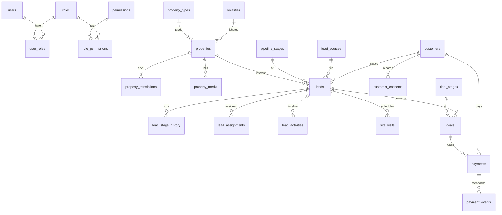
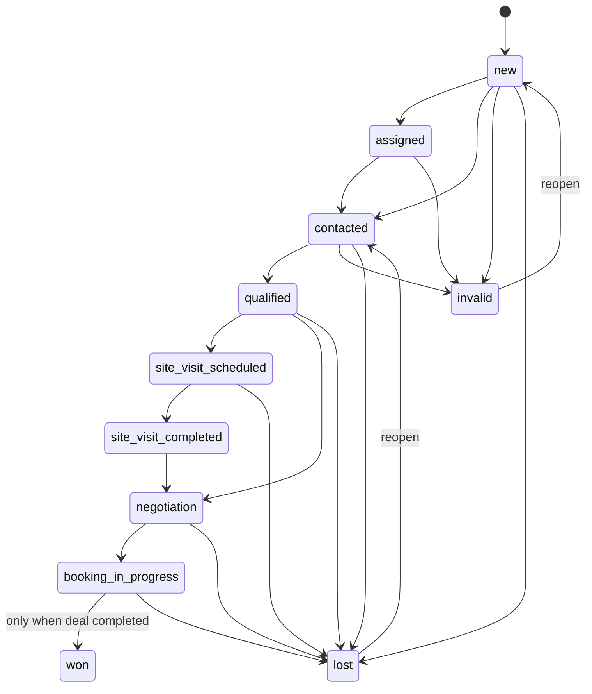
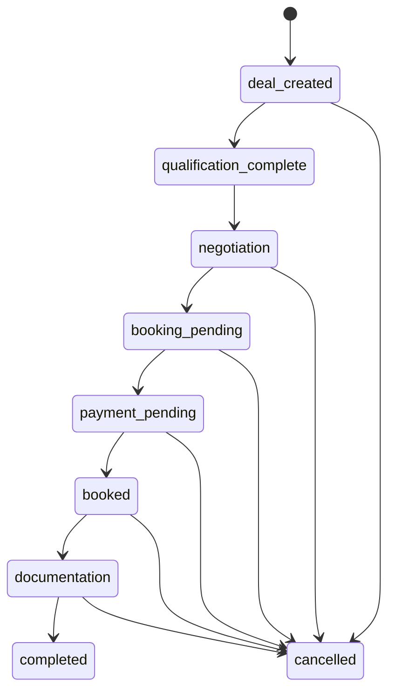

# DATABASE_DESIGN.md

PostgreSQL 17, one database, Flyway migrations in `services/api/src/main/resources/db/migration` (V1–V8). Hibernate/JPA is not used for the first slice; SQL is explicit and the schema is the source of truth. **Applied and tested 2026-11-07** on PostgreSQL 17.11 (clean local volume, existing local DB, Testcontainers). See TEST_RESULTS.md.

## Migration map
| File | Content |
|---|---|
| V1 | extensions (pg_trgm), `set_updated_at()`, reference sequences |
| V2 | users, roles, permissions, role_permissions, user_roles, user_sessions |
| V3 | localities, property_types, amenities, projects (+translations/media/units), properties, property_translations (tsvector+GIN), media, documents, status/price history |
| V4 | CRM: lead_sources, pipeline_stages(+transitions), lost_reasons, customers, preferences, consents, duplicate candidates, merges, channel_partners, leads, qualifications, priority_rules, stage history, assignments, activities, notes, tasks, communication_logs, segments, campaigns |
| V5 | site_visits(+history), deal_stages(+transitions), deals(+history, documents), payments, payment_events, refunds |
| V6 | outbox_events, processed_events, notification_jobs/logs/preferences, site_settings, company_offices, CMS pages/banners/FAQs, reviews, audit_logs (append-only trigger), data_subject_requests |
| V7 | reporting views |
| V8 | reference data (roles, permissions, pipeline, lost reasons, sources, types, amenities, unverified company profile) |
| V9 | customer accounts: `customers` + whatsapp_e164/whatsapp_verified_at/registered_at/signup_source; `customer_identities` (UNIQUE provider+subject), `customer_sessions` (token hash), `phone_verifications` (HMAC code hash, attempts, expiry); lead source `website_account`; activity types `account_registered`, `phone_verified` |
| V10 | staff web sign-in: `roles.requires_mfa` (director), `staff_auth_requests` (state hash, nonce, PKCE verifier; single use), `user_sessions.auth_methods` |
| V11 | lead workflow: Invalid requires a reason, `lead_stage_history.reason_code` + trigger (Lost/Invalid need a reason), `lead_assignments.previous_assigned_to`, `site_visits.employee_notes` + checks (no completion before the scheduled time, assignee when scheduled), `crm_tasks.priority` + `site_visit_id` + unique index against duplicate open follow-ups, permission `visit.manage_all` (director) |
| V12 | `user_sessions.id_token_hint` for OIDC RP-initiated logout (server-side only, erased on logout) |
| seed-local V1000 | synthetic users, localities, `[SAMPLE]` properties, 2 leads. Loaded only by `local` and `test` profiles |

## Entity relationships

## Lead pipeline

## Deal lifecycle (inactive until approved)

## Constraints that carry business rules (tested in DatabaseConstraintsIT: PASS)
- Published property needs a price or `price_on_request`; price never zero.
- Lost lead needs a reason; `other` needs a note.
- Customer phone/email **not unique** (families, agents share numbers).
- One open deal per lead+property (partial unique index).
- `audit_logs` is append-only (trigger rejects UPDATE/DELETE).
- Payment gateway order/payment ids and webhook event ids unique (idempotent webhooks).
- Consents append-only by convention (history table, no updates in code).
- One customer per Google account: `uq_customer_identity (provider, provider_subject)`.
- A verified WhatsApp timestamp requires a WhatsApp number (`ck_customers_whatsapp_verified`); OTP attempts bounded by `max_attempts`.
- Local dev only: seed is V1000, so the local profile sets `flyway.out-of-order=true` (D-015).

## Indexes
Public search: partial indexes on `status='published'`, GIN on `search_vector` and trigram on locality; keyset ordering `(published_at, id)`. Leads: `(assigned_user_id, stage_id)`, `(created_at, id)`, `next_action_at` partial. Outbox: partial on pending/due.

## Known design gaps
- No Row Level Security yet; record-level rules are in application SQL (consider RLS before production).
- Public search vector uses `simple` config; Hindi stemming is not available. Trigram `ILIKE` supplements it.
- Retention/erasure jobs (DPDP) specified, not implemented.
