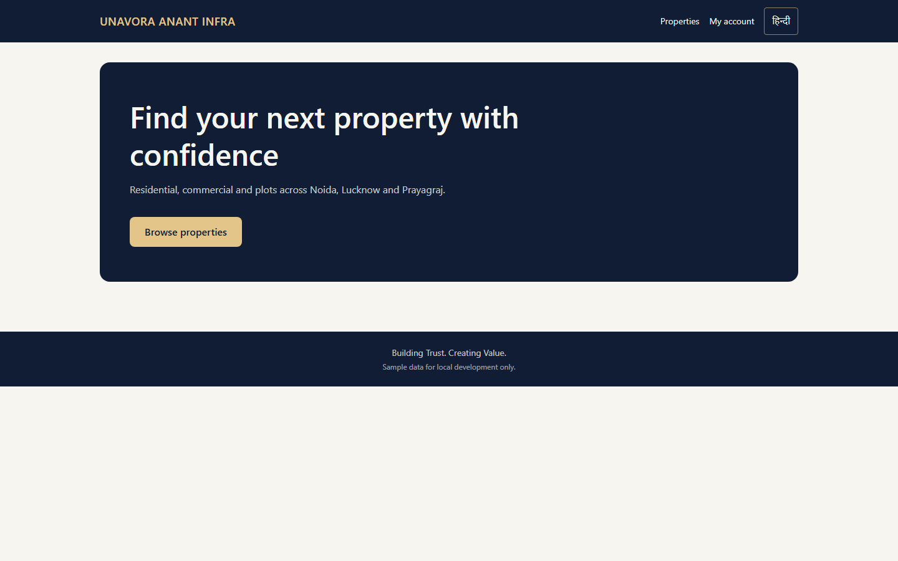
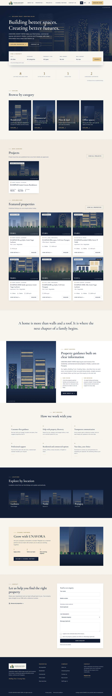

# UI_REVIEW.md — public website redesign (2026-11-08)

Status: **implemented locally, not committed.** All results below were executed on the local Windows PC against the
production build (`next build` + `next start`) with the local API, PostgreSQL and Keycloak. Screenshots:
`docs/ui-review/before/` (old site) and `docs/ui-review/after/` (new site, full pages).

## 1. Inputs and how they were used

| Input | Used for | Not used |
|---|---|---|
| Official logo sheet (owner, 2026-11-08: final) | Horizontal lockup in header and footer, UAI monogram for favicon/app icons and phones < 360 px, stacked logo on About and the social preview image. Cut from the sheet without altering artwork (`assets/brand/make_logo_assets.py`) | IA monogram from the old mock-up |
| Brand palette (#101D35, #E3C58A, #F7F5F0, #64748B) | All tokens in `globals.css`. For small **text** on light backgrounds two accessible tints were added: deep gold `#7D5F27` and muted slate `#56657A` (WCAG AA; see §7) | — |
| Video design reference | Style only: warm light surfaces + dark footer, small tracked gold labels with hairlines, large serif display type, square gold buttons, split editorial sections, image tiles with text over a gradient, hairline figure strip, scroll-revealed statement, calm centred enquiry | Its splash screen, prices, unit counts, handover dates, text, imagery |
| teamamanchawla.com (structure study only) | Information architecture ideas: category dropdowns, city discovery, new launches, partner programme, short enquiry forms, floating contact actions | Code, text, photos, logos, ratings badge, counters, developer logos, press logos |
| CONTENT_AND_ASSET_REGISTER / PENDING_BUSINESS_CONFIRMATIONS | Every claim checked against them; unverified company facts never shown | Unverified phone, email, legal name, director, offices, RERA, CIN |

## 2. Previous design problems (before)

- Home: a navy text box, one button and an empty half-screen; no imagery, search, categories, listings or contact path.
- Header: brand text, two links and a language button; no navigation to categories, projects, about or contact.
- Footer: tagline only; no navigation, legal links or contact route.
- Listing: plain white cards, no images, no filters in the UI (the API supported them), no pagination, no empty state.
- Detail: title, price and form only; no gallery, facts hierarchy, location, related listings or mobile contact bar.
- Missing pages: About, category pages, Projects, Channel partner, Contact, Privacy, Terms; no branded 404/error/loading.
- Staff screens shared the public header (any public redesign would have changed the CRM).
- SEO: one generic title; no canonical, hreflang alternates, Open Graph, sitemap or robots.

## 3. Pages redesigned or added

| Page | Route (en and hi) | Data source |
|---|---|---|
| Home | `/en` | listings, locations, projects, category counts, verified company facts (all live) |
| About us | `/en/about` | copy (draft, §9) + live locations |
| Properties / search | `/en/properties` | `GET /api/v1/public/properties` (city, category, type, budget, keyword, paging) |
| Residential / Commercial / Plots and land | `/en/residential`, `/en/commercial`, `/en/plots` | same, with `category` fixed |
| Office spaces | `/en/properties?type=office` (card shown only when listings exist) | same |
| Property detail | `/en/properties/{slug}` | detail API + related listings |
| Projects / new launches | `/en/projects` | `GET /api/v1/public/projects` (published only) |
| Project detail | `/en/projects/{slug}` | project detail API (RERA only when verified) |
| Channel partner | `/en/channel-partner` | `POST /api/v1/public/channel-partners` |
| Contact us | `/en/contact` | enquiry API with enquiry type; verified contacts only |
| Privacy policy, Terms and conditions | `/en/privacy`, `/en/terms` | honest interim text (PENDING #9) |
| Not found / error / loading | any unknown URL; error boundary; list-page skeletons | — |
| Customer account | `/en/account` (unchanged content, new site chrome) | unchanged |
| Staff / director CRM | `/en/staff/**` | **unchanged**: keeps the previous header/container/footer via `staff/layout.tsx` |

## 4. Components introduced (`apps/web/src/components/site/`)

`Header` (sticky; Properties and Projects dropdowns that open on hover **and keyboard focus**; language switch that
keeps the current page and filters; account; Enquire now), `HeaderClient` (mobile drawer: dialog semantics, Esc,
focus in/out, scroll lock), `Footer` (logo on a warm-white plate, navigation, verified contacts only, legal, dynamic
year), `Logo`, `Art` (code-drawn architectural illustrations, deterministic per listing), `SearchPanel` (hero search,
listing filter bar, phone **bottom sheet** `SearchSheet`), `ListingView`, `PropertyCard` (rewritten), `ProjectCard`,
`PageHero`, `PartnerForm`, `LegalPage`, `ListingSkeleton`, `ui` (buttons, eyebrow, headings, icons). `EnquiryForm`
gained layouts (property / callback / full with enquiry type). SEO helpers in `lib/seo.ts`; site helpers in
`lib/site.ts`; asset manifest in `lib/assets.ts`.

## 5. Backend additions (additive; existing behaviour unchanged)

| Change | Why | Tests |
|---|---|---|
| Listing fields `typeCode`, `category`; search parameter `category` (unknown → 400) | category pages and card art need stable codes; "Residential" spans several types | PublicPropertyIT (+2) |
| `GET /api/v1/public/locations` | database-driven location cards and city filter | PublicPropertyIT |
| `GET /api/v1/public/projects`, `/projects/{slug}` | projects / new launches; published only; RERA hidden unless verified | PublicSiteIT |
| `GET /api/v1/public/company` | footer/contact show **only** verified settings and offices | PublicSiteIT |
| Enquiry `enquiryType` (general, callback, site_visit, residential, commercial, project) | contact form "I am interested in"; unknown → 422; property enquiries stay `property` | PublicSiteIT |
| `POST /api/v1/public/channel-partners` | partner record (status applied, RERA "declared, not verified") + CRM lead `channel_partner`, unassigned for the director | PublicSiteIT |
| Local profile only: enquiry rate limit 200/hour (default 10 everywhere else) | the browser suite submits many public forms from one IP; the limiter itself is still tested at 10 | EnquiryAndLeadFlowIT unchanged |

OpenAPI 0.5.0 documents all of the above. New module boundary rule for `content.internal` (ArchUnit).

## 6. Assets: used and missing

| Asset | Status |
|---|---|
| Official logo (sheet, JPEG 1280×853) | USED: horizontal lockup, monogram, stacked logo, favicon, app icons, social image |
| Logo vector master + reversed (on-dark) version | MISSING; cut-outs are used on light surfaces only |
| Property and project photographs | MISSING; labelled code-drawn illustrations used. Never presented as real properties |
| Hero / about / partner photographs | MISSING; slots ready in `lib/assets.ts` (company photos and licensed stock kept apart; stock would be captioned "Representative image" and never used on listings) |
| Director photograph | not used (never invented) |
| Fonts | Cormorant Garamond (display) + Inter (body), Noto Serif/Sans Devanagari for Hindi; self-hosted by `next/font` at build |

## 7. Accessibility and SEO checks

| Check | Result | How |
|---|---|---|
| Structure: one h1, no skipped heading levels, `lang`, `<main>`, skip link, alt text, labelled controls, named links/buttons, no duplicate ids, targets ≥ 24 px | **PASS 18/18 pages at 320 px and 18/18 at 1440 px** (en + hi + 404) | `apps/web/scripts/a11y-check.mjs` in Chromium |
| Colour contrast (WCAG AA) | **FAIL → fixed**: champagne gold on warm white is 2.1:1 and slate 4.37:1 / 4.08:1 on sand; small text now uses #7D5F27 (5.45:1) and #56657A (5.45:1); gold on navy 10.1:1 | computed ratios |
| Keyboard | dropdowns open on focus, drawer closes with Esc and returns focus, filter sheet is a native `<dialog>`, visible gold focus ring | Playwright + review |
| Reduced motion | entrance, hover and scroll-reveal animations off | CSS `prefers-reduced-motion` |
| Metadata: title ≤ 70, description, canonical, hreflang en/hi/x-default, Open Graph, valid JSON-LD | **PASS 16/16 pages**; sitemap.xml (29 URLs, alternates) and robots.txt served | `scripts/seo-check.mjs` |
| Missing listing returns HTTP 404 | **PASS** (loading skeletons limited to list pages so detail pages are not "soft 404s") | seo-check, Playwright |
| Structured data | `RealEstateAgent` (name, logo, tagline, served cities; phone/email only if verified), `RealEstateListing` with offer price, project `Residence`. No ratings, reviews or RERA claims | rendered HTML |
| robots.txt | blocks everything unless `SITE_INDEXABLE=true` (production only), so local/staging is never indexed | — |
| axe-core / Lighthouse | **NOT RUN** (no new dependency added); recommended before go-live | — |

## 8. Mobile testing

| Width | Pages checked for sideways overflow | Result |
|---|---|---|
| 320, 375, 390, 430 (phones), 768 (tablet), 1440 (desktop) | home, about, listing, plots, property detail, projects, project detail, partner, contact, privacy, 404, Hindi home and listing | **PASS 78/78** (after fixes below) |

Phone design: monogram header below 360 px, drawer navigation, stacked hero buttons, two-up search fields, swipeable
featured cards, filter bottom sheet with active-filter count, sticky price + Enquire bar on property pages (call and
WhatsApp buttons appear only once verified numbers exist), single-column footer.

## 9. Content restrictions honoured

- Not rendered until real, approved content exists: **news/insights/videos** (no CMS article model yet), **testimonials**
  (no published reviews with permission), **developer associations** (none evidenced), **favourites** (no API).
- No invented prices, statistics, ratings, awards, guarantees, RERA or contact details. The figure strip shows live
  counts (listings, cities, localities, languages).
- Sale/rent is not offered (all listings are for sale; no rent data). Greater Noida appears only when listings exist.
- **Draft copy for director approval:** hero headline/sub-text, About text, **vision, mission, values and approach**,
  "Why UNAVORA" cards, channel-partner steps, privacy/terms interim text. Hindi is a draft for native review.
- Local-only `[SAMPLE]` data: 8 listings and one sample project (`infra/local/manual-test-data.sql`).

## 10. Functional issues found and fixed during the redesign

1. Staff dashboards would have inherited the new public header → staff routes now have their own layout (unchanged look).
2. Server-to-client error: dictionary functions passed to form components → forms receive plain strings only.
3. Phones: 17 px sideways scroll from a `hidden` + `inline-flex` class conflict on header buttons → fixed.
4. Plot illustrations lost their ground in 4:3 crops → crops anchored to the ground line.
5. Desktop navigation wrapped at 1440 px → tightened, account icon-only below 2xl.
6. Search dropdown values inherited label letter-spacing → reset.
7. Soft 404 (HTTP 200) for missing listings/projects → loading boundaries moved to list pages; branded 404 for any unknown URL.
8. Contrast failures (§7) → accessible text tints.
9. Heading-level jump on project list, small breadcrumb targets (incl. Hindi "होम"), short Hindi description, duplicated home title → fixed.
10. Project page overflow on phones (unit table min-width stretched the grid) → `min-w-0` grid.
11. Partial facts rows showed grey cells → hairline borders.
12. Full browser suite hit the public enquiry rate limit (10/hour/IP, correct behaviour) → local profile limit raised; tests unchanged.

## 11. Test results (local, 2026-11-08)

| Suite | Result |
|---|---|
| API `mvn verify` | **PASS 86/86** (6 ArchUnit + 80 integration, incl. new PublicSiteIT 4 and PublicPropertyIT 10) |
| Web TypeScript | PASS (0 errors) |
| Vitest | **PASS 11/11** (new `site.test.ts` 8) |
| Next.js production build | PASS |
| Playwright (mobile + desktop, real Keycloak + director TOTP) | **PASS 50/50**: existing 34 unchanged (staff, director MFA, lead workflow, enquiry, customer Google/WhatsApp mock signup) + new `site.spec.ts` 16 |
| Business-flow / customer-signup scripts | PASS 19/19, 25/25 |
| Accessibility / SEO / overflow scripts | PASS (§7, §8) |
| Manual inspection | Screenshots of every page reviewed at desktop and phone widths; issues in §10 fixed. Owner's own review in Chrome still to do |

## 12. Screenshots (after)

Desktop (1440, scaled to 1100): [home](ui-review/after/home-1440.jpg) · [home hi](ui-review/after/home-hi-1440.jpg) ·
[about](ui-review/after/about-1440.jpg) · [listing](ui-review/after/listing-1440.jpg) · [residential](ui-review/after/residential-1440.jpg) ·
[plots](ui-review/after/plots-1440.jpg) · [property detail](ui-review/after/detail-1440.jpg) · [projects](ui-review/after/projects-1440.jpg) ·
[project detail](ui-review/after/project-detail-1440.jpg) · [channel partner](ui-review/after/channel-partner-1440.jpg) ·
[contact](ui-review/after/contact-1440.jpg) · [contact hi](ui-review/after/contact-hi-1440.jpg) · [privacy](ui-review/after/privacy-1440.jpg) ·
[404](ui-review/after/not-found-1440.jpg)

Phone (390): [home](ui-review/after/home-390.jpg) · [home hi](ui-review/after/home-hi-390.jpg) · [about](ui-review/after/about-390.jpg) ·
[listing](ui-review/after/listing-390.jpg) · [property detail](ui-review/after/detail-390.jpg) · [project detail](ui-review/after/project-detail-390.jpg) ·
[channel partner](ui-review/after/channel-partner-390.jpg) · [contact](ui-review/after/contact-390.jpg)

All widths (home, listing, detail): 320, 375, 390, 430, 768, 1440 in `ui-review/after/`.

## 13. Still needed from the business

1. Logo vector master (SVG/AI/PDF) and a reversed version for dark backgrounds.
2. Real photography: hero, about, partner banner; property and project photos (with permission).
3. Verified contact details: phone, WhatsApp number, email, office addresses (enable by setting `verified = true`).
4. Approval of draft copy (§9) and native review of Hindi.
5. Privacy policy and terms (PENDING #9, #21).
6. Real projects, approved reviews with permission, evidenced associations, CMS articles/videos (sections appear once data exists).
7. Official social media URLs (stored as `social.<name>` settings, verified).
8. Production `SITE_URL`; `SITE_INDEXABLE=true` only on the live site.

## 14. Known limitations

- Logo files come from a JPEG sheet; fine at header/footer sizes, not for large formats.
- Illustrations stand in for photography; the site's visual quality will step up with real photos.
- `next start` warns about `output: standalone` (pre-existing; the container image runs the standalone server).
- Two build warnings about `metadataBase` come from Next's built-in global not-found route (no social image to resolve).
