# WEBSITE_UI_UX_REVIEW.md — premium website experience (2026-11-09)

Status: **implemented locally, not committed** (awaiting owner approval). Built in four phases from the owner brief
"Premium Website Experience Redesign": A design system, header, hero and homepage; B discovery; C about, partner,
owner, Insights, media and contact; D CMS/CRM, SEO, accessibility, performance and QA. Everything below was executed
against the local production build (`next build` + `next start`) with the local API, PostgreSQL and Keycloak.
Test evidence: TEST_RESULTS §14. Competitor study: COMPETITOR_UI_UX_ANALYSIS.md.

Screenshots: `docs/ui-review/premium/` (this release). The previous release (`7f8f9e2`) is in `docs/ui-review/after/`
and serves as "before" here. All listings in screenshots are `[SAMPLE]` synthetic data.

## 1. Before → after

| Area | Before (`7f8f9e2`) | Now |
|---|---|---|
| Hero | navy panel, inline search | full-bleed licensed photo (labelled "Representative image"), new headline, two clear actions; phone: one-tap property finder sheet instead of a long form |
| Header | all links from 1024 px (overflowed at 1024) | desktop nav from 1280 px, drawer below; active page marked; "List your property" under Properties; Insights only when content exists |
| Categories | text tiles | four photographic tiles (labelled representative photos) |
| Listings | newest only | sort by newest, price low→high, high→low, featured; director chooses featured homepage listings |
| Property detail | single illustration | photo gallery and floor plans when media exist (illustration otherwise), save to favourites, city-page and map links |
| Projects | list | status filter (planned / under construction / ready to move / completed), developer name |
| Locations | home cards only | city pages `/locations/{city}` with CRM-managed introduction and the city's listings (only for cities with public listings) |
| Owners | none | "List your property" with up to 5 private photos → CRM review → director decision; never auto-published |
| Customer account | profile + WhatsApp | plus saved properties, my enquiries (customer-facing status), my site visits |
| Content | none | Insights (articles + videos, categories, search, sharing, JSON-LD), consented testimonials, all managed in the CRM |

## 2. Screenshots

**Homepage, desktop (1440 px)** and **mobile (390 px)**

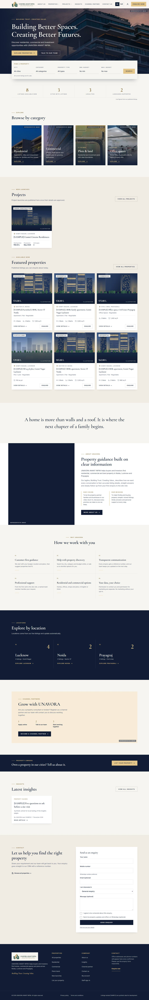

**Property search**: 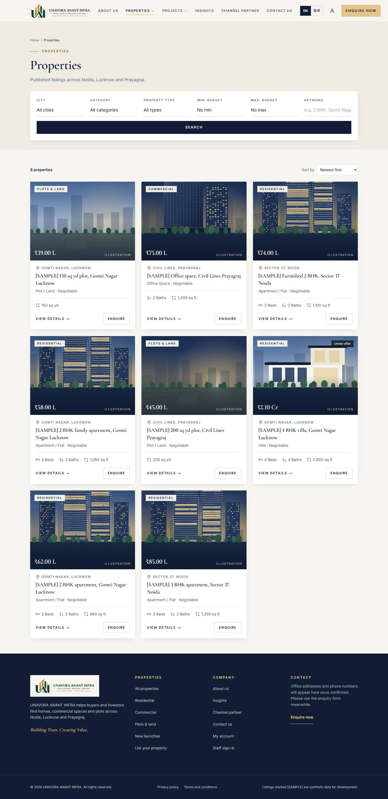 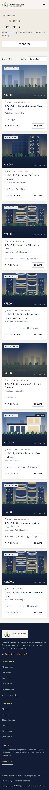

**Property detail**: 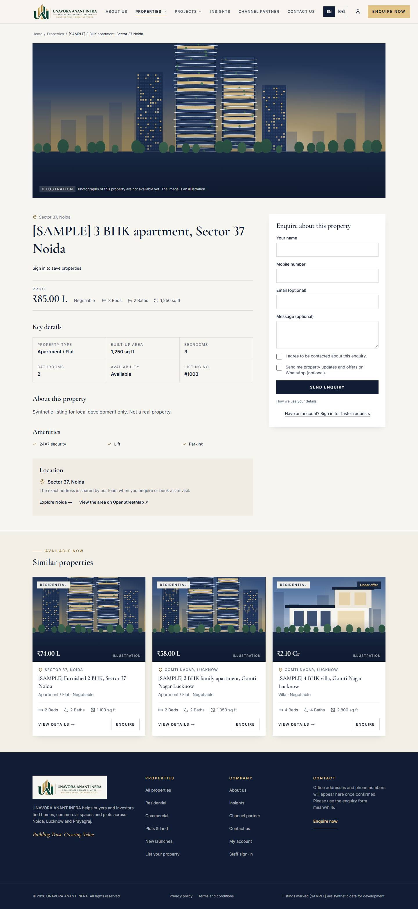 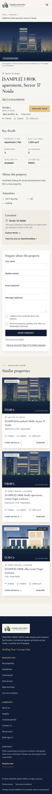

**New launches (projects)**: 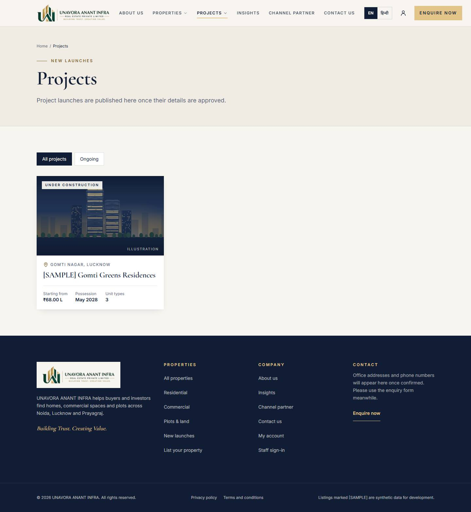 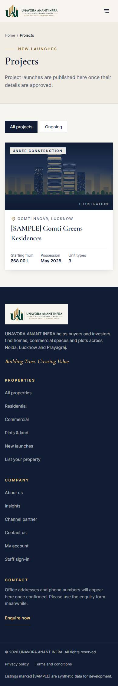

**About**: 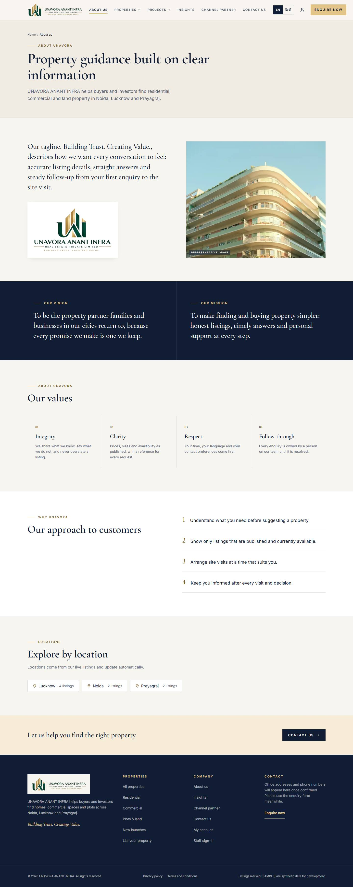 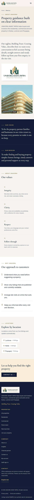

**Contact**: 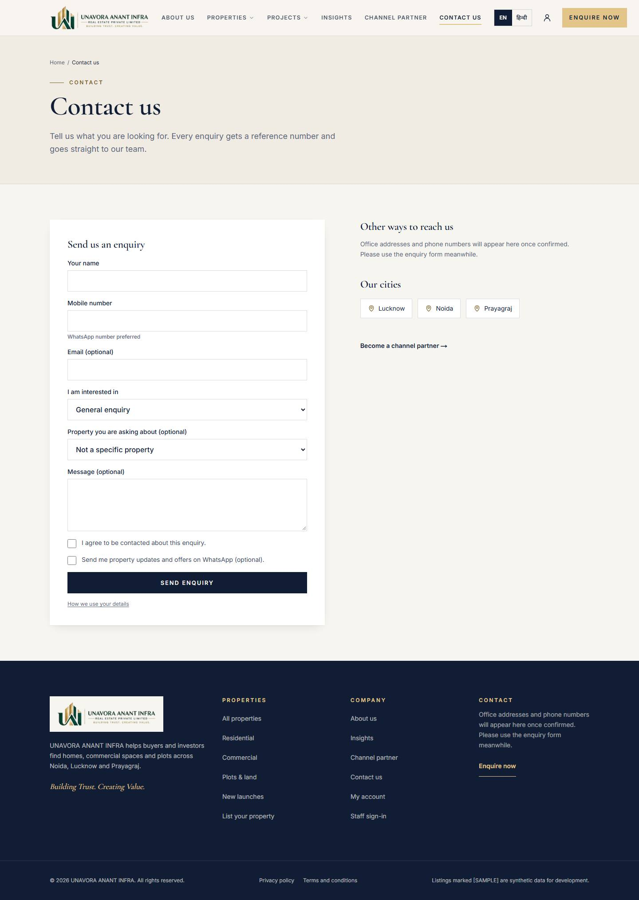 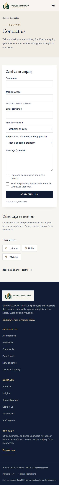

**Customer account** (mock Google sign-in, one saved property): 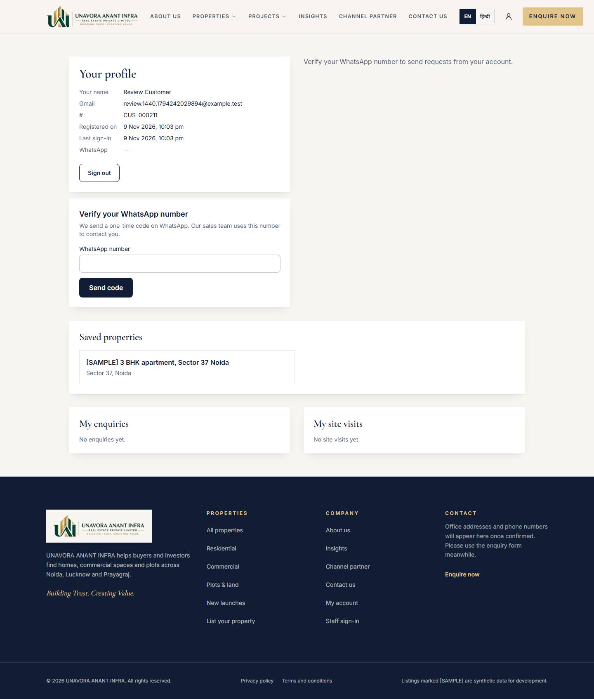 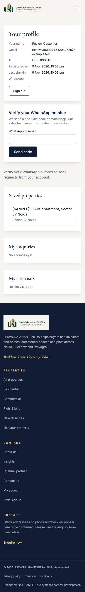

Also: [Insights](ui-review/premium/insights-1440.jpg), [City page, Lucknow](ui-review/premium/location-lucknow-1440.jpg),
[List your property, mobile](ui-review/premium/list-your-property-390.jpg).

## 3. Pages completed

Public: home, all properties, residential, commercial, plots, property detail, projects (list + detail), city pages,
about, channel partner, list your property, Insights (list + article/video), contact, customer account, privacy,
terms, 404/error/loading. English and Hindi throughout.

CRM (staff): Owner submissions (list, detail with private photos, review, director decision) and Website content
(Insights editor, testimonials, featured listings, city introductions, company facts and offices). Menu items appear
only for staff with the matching permission; employees are refused on content screens (tested).

## 4. Functional checks (all automated, all passing)

| Journey | How verified |
|---|---|
| Owner submits property with photo → lead + submission, no listing | Playwright + `PublicSiteContentIT` |
| Employee/director review → director approve; photo private (`no-store`) | Playwright (desktop) + IT |
| Director publishes Insight in CRM → visible on site with share links + JSON-LD | Playwright |
| Customer signs in (mock Google), saves a property, sees it in the account with enquiries | Playwright + IT |
| Price sort order; city page 200; unknown city 404 | Playwright + IT |
| Testimonial cannot be published without consent | IT (DB constraint → 409) |
| Earlier flows (search, enquiry, lead workflow, staff sign-in, customer sign-up) | full Playwright suite 59/59, flow scripts 19/19 + 25/25, `mvn verify` 94/94 |

## 5. Accessibility

Structural script (one h1, heading order, landmarks, skip link, labels, alt text, unique ids, 24 px targets) passes
on 12 pages at 320 px and 1440 px after fixing one small tap target. Contrast tokens from the previous release are
kept (AA). Videos do not autoplay (click to load). Keyboard use of the gallery and finder sheet was not separately
tested beyond the structural checks.
**Not run:** axe-core, screen-reader pass, Lighthouse.

## 6. Performance (lab measurements, `apps/web/scripts/perf-check.mjs`)

Mobile = 390 px, 4× CPU slowdown, ~9 Mbps / 150 ms latency, cold cache. Desktop = 1440 px, no throttling.

| Page | Mobile LCP | Mobile CLS | Mobile INP~ | Desktop LCP | Desktop CLS |
|---|---|---|---|---|---|
| Home | 1652 ms | 0.000 | 64 ms | 444 ms | 0.000 |
| Properties | 1300 ms | 0.000 | 24 ms | 368 ms | 0.000 |
| Property detail | 1076 ms | 0.000 | 16 ms | 384 ms | 0.000 |
| Projects | 792 ms | 0.000 | 0 ms | 204 ms | 0.000 |
| City (Lucknow) | 948 ms | 0.000 | 16 ms | 244 ms | 0.000 |
| Insights | 676 ms | 0.000 | 40 ms | 168 ms | 0.000 |
| List your property | 936 ms | 0.000 | 32 ms | 264 ms | 0.000 |
| About | 748 ms | 0.000 | 0 ms | 208 ms | 0.000 |
| Contact | 1012 ms | 0.000 | 40 ms | 144 ms | 0.000 |

All within Google's "good" thresholds (LCP ≤ 2.5 s, CLS ≤ 0.1, INP ≤ 200 ms). These are **lab** numbers on a local
server; field data needs real users after launch. INP is approximated from one click and one key press per page.
Home transfers ~0.66 MB on mobile (mostly the hero photo, served as responsive WebP by `next/image`).

## 7. Missing business assets (needed before launch)

- Real photographs of listings and projects (and the public media store to upload them).
- ~~Verified phone and email~~ **verified 2026-11-12** (+91 83183 77108, info@anantinfrarealty.com; CONTENT_READINESS_CHECKLIST). Still pending: WhatsApp number, office addresses, legal details (RERA/CIN); the site shows none of these until marked verified in CRM → Company facts.
- Approved company copy (About, vision/mission) and real Insights articles.
- Testimonials with written display consent.
- Partner/developer logos with permission; social media URLs.

## 8. Not implemented (by design or pending decisions)

- ~~CMS for homepage banners/hero text, category tiles, SEO overrides, partner logos, careers page~~ done in round 2 (Director CMS).
- ~~Listing photo upload~~ done in round 2 (local disk adapters); S3/CDN public media storage still needs infrastructure approval.
- Malware scanning: pipeline and `clamd` adapter done in round 2; a real ClamAV / S3 scanning service is still required before staging.
- Turning an approved owner submission into a listing (manual CRM step by decision).
- Real Google sign-in and real WhatsApp: still mock only (not enabled without approval).
- Map embed: an OpenStreetMap link to the area is shown; no embedded map or exact address (privacy).

## 9. Known limitations

- Homepage Insights/featured sections refresh within 60 s (ISR), not instantly after a CRM change.
- Local test runs leave `E2E guide …` articles in the local database (CI uses a fresh database); archive them locally if they appear.
- `next start` warns about `output: standalone`; production will run the standalone server.
- Owner photos are stored on the API host's disk locally; staging needs a private S3 bucket.

---

# Round 2 — final website completion (2026-11-10, uncommitted)

Brief: "UNAVORA final website completion — video audit + UI/UX + authenticity + full functionality".
Audit: FINAL_VIDEO_AUDIT.md. Plan: WEBSITE_COMPLETION_PLAN.md. Journeys: WEBSITE_FUNCTIONALITY_MATRIX.md.
Business inputs: CONTENT_READINESS_CHECKLIST.md. Screenshots: `docs/ui-review/final/` (account screenshots from
round 1 in `docs/ui-review/premium/` remain valid; the account page only gained the new footer).

**The site is NOT production-ready**: malware scanning service, real media storage (S3/CDN), approved business
content (photos, contacts, projects, social accounts) and the final privacy notice are still missing.

## What changed (video findings → fixes)

| Video finding | Fix |
|---|---|
| [SAMPLE] listings/projects look like real records; counts of samples shown as "live figures" | `is_sample` on all public content; hidden from every public API unless the deployment is local/test; startup guard; red "Sample data" badge locally; figures strip removed |
| "E2E guide" articles public | tests archive their content; `infra/local/cleanup-test-data.sql` (+ read-only report) |
| New launches buried below categories | New Launches directly under the hero search (swipe carousel on phones), dedicated page with search, filters, pagination, empty state |
| Same illustration repeated on unrelated listings | honest "Photographs awaiting approval" placeholder; real photos only after scan + approval |
| Footer without social links/contacts | redesigned footer with official social icons, verified contacts, offices, hours, directions; collapses on phones |
| No way to put real content in | CRM listings/projects workflow, photo pipeline, Director CMS, Create Draft Listing |

## Screenshots

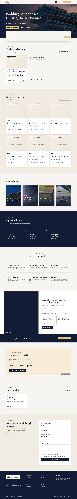

[Property search](ui-review/final/search-1440.jpg) · [search mobile](ui-review/final/search-390.jpg) ·
[property detail](ui-review/final/detail-1440.jpg) · [detail mobile](ui-review/final/detail-390.jpg) ·
[New launches](ui-review/final/new-launches-1440.jpg) · [project detail](ui-review/final/project-detail-1440.jpg) ·
[About](ui-review/final/about-1440.jpg) · [Contact](ui-review/final/contact-1440.jpg) ·
[Insights](ui-review/final/insights-1440.jpg) · [City page](ui-review/final/location-lucknow-1440.jpg) ·
[Customer account](ui-review/final/account-1440.jpg) · [account mobile](ui-review/final/account-390.jpg) · [New launches mobile](ui-review/final/new-launches-390.jpg)

## Quality results (standalone server `node .next/standalone/server.js`)

| Check | Result |
|---|---|
| axe-core (WCAG 2.0/2.1/2.2 A+AA), 12 pages × 390/1440 | **24/24 pass** (after fixing ARIA on Insights filters and a keyboard-inaccessible scroll table) |
| Structural a11y script, 12 pages × 320/1440 | 24/24 pass |
| Keyboard (scripted): skip link, finder sheet, menu drawer, gallery viewer, footer accordion | pass (keyboard.spec.ts, journey B) |
| Screen reader | **not run** (no screen reader available to the agent) — owner/manual task with NVDA or TalkBack |
| Lighthouse mobile (8 pages) | Performance 86–96, Accessibility 100, Best practices 100, SEO 69* |
| Lighthouse desktop (8 pages) | Performance 99–100, Accessibility 100, Best practices 96 → fixed (logo rendition), SEO 69* |
| Lab Web Vitals (perf-check, 4× CPU, ~9 Mbps mobile) | mobile LCP 0.75–2.6 s, CLS 0.000, INP~ 24–168 ms (one 480 ms outlier not repeatable: 48/40 ms on reruns); desktop LCP 0.18–0.6 s |
| Overflow, 14 pages × 320/360/375/390/430/768/1280/1440/1920 | 0 real overflow (1280 px header overflow found and fixed); carousel flags are intentional swipe strips |
| Broken links/images crawl | 28 pages, 0 broken (language-switch 404s on detail pages found and fixed) |
| SEO script | pass (canonical, hreflang with real per-language slugs, OG, JSON-LD, sitemap 40 URLs, robots, 404) |

*SEO 69 only because the local build sends `Disallow: /` (non-production). Field (real-user) Core Web Vitals can only
be measured after launch.

## Known limitations

- Local photo scanning uses a **mock** scanner (EICAR test string only); `clamd` adapter exists and is unit-tested
  against a fake daemon, never against a real ClamAV.
- Approved media is served by the API from local disk (`/api/v1/public/media`), not S3/CDN.
- Google and WhatsApp remain mock (CONTENT_READINESS_CHECKLIST §4).
- Hindi wording is a draft; many records have English only (the language switch falls back to English).
- Docker Desktop on this PC stopped twice under load during testing; results above were re-measured after restart.

---

# Round 3 — illustrative showcase and CMS replacement (2026-11-12, uncommitted)

Source of truth for business facts: CONTENT_READINESS_CHECKLIST.md. Gap report and stage results: SHOWCASE_GAP_REPORT.md.
Status by category: LAUNCH_READINESS_REPORT.md.

| Area | Now |
|---|---|
| Content types | A real inventory (unchanged workflow) · B illustrative showcase (`showcase_items`, V18) · C local synthetic data (`is_sample`, now also on showcase items, V19) |
| Homepage order | hero + finder → New launches → Featured properties (real listings only; hidden when none) → Explore property styles (illustrative) → categories → locations → … |
| No real launch | "Discover upcoming opportunities": representative image + Register your interest (general project lead, no project id) |
| Showcase cards | "Illustrative example" label (navy/gold), disclosure above the cards, category chips; no price/size/date/RERA/availability; never in property search or structured data |
| CMS | CRM → Website content → Showcase: English/Hindi text, category, position, button, image from the approved library (replace any time), optional link to a published real property/project, desktop + phone preview, submit / publish / unpublish / archive, audit history |
| CRM | showcase and register-interest enquiries: source "Website - showcase / register interest", campaign, preferred location, no property id; the lead page shows source, campaign and location |
| Contact display | phone shown as "+91 83183 77108", links `tel:+918318377108`; mobile footer accordions stack tightly |

Known limitation (observed 2026-11-12): after a CMS change, a public page pre-rendered at build time may keep its
previous version until its 60-second refresh (seen on `/hi`; `/en` updated at once). The browser test allows that window.
